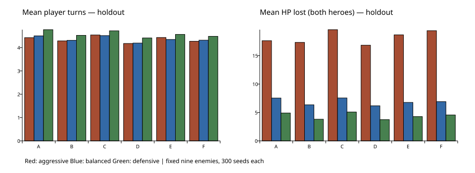

# Card Upgrades & Power Curve v1 — исследование

20.10.2026. Улучшения реализованы; старт игры остаётся **18/8**. Все 23 числа совпадают с PROTOTYPE §5.2. [Технический отчёт](card-upgrades-v1-report.md).

## Вывод и границы решения

Улучшения дают измеримый, но умеренный прирост. При том же составе 2 улучшения (B→D) сокращают бой примерно на 3%, 4 улучшения (C→E) — на 3–4%. Это **не достигает ориентира E03 ≥15% темпа**. Защитные улучшения заметнее по HP: у готовой armor-сборки balanced уменьшение потерь около 16%, тоже ниже ориентира 20%. Простое добавление восьми обычных карт C почти не улучшает balanced относительно A. Система развития работает, но проблему выраженной кривой силы этот бюджет целиком не решает.

Обмен лечения на улучшение имеет настоящую цену. На safe-маршруте holdout balanced теряет 3.2 п.п. побед (90.2→87.0%) при фиксированной политике развиваться, если оба героя имеют ≥65% HP. Это не доказывает вред улучшений: меняются и сила, и упущенное лечение, и последующий публичный маршрут. Порог 65% не настраивался на holdout и не является рекомендацией игроку.

**Рекомендация по старту:** C14/8 — основной кандидат следующего человеческого/маршрутного теста; C16/8 сохранить как более широкий контроль. C14/7 уступает C14/8 при строго одинаковом составе. Сейчас не переводить игру с 18/8 автоматически: C14/8 быстрее, но balanced теряет немного больше HP Джайны, planner-shortlist имеет лишь 16+16 seed, а полные маршруты со сравнением компактных стартов и новой ценой привала ещё не проверены. 18/8 остаётся текущим производственным контролем.

## Протокол

Основная выборка **410000–410299**, независимая holdout **510000–510299**, три неизменённых бота aggressive/balanced/defensive, public-информация. По **300+300 seed на каждого из девяти противников v10** и каждую конфигурацию. Planner: A–F **60+60**, старт/архетипы **16+16 (screening)**. Его профиль/лимиты прежние: beam 30, 900 узлов, depth 12. Полные походы: **500+500** на классическую пару route/rest policy, planner **30+30 screening** только safe. Итого **372 600** классических и **11 376** planner-боёв, **8 120** настоящих походов. Все исходы включены; таймаутов 0.

Изолированные бои начинаются с полным HP 25/18, без предметов; одни и те же seed, враги, экономика B и составы внутри пар B/D, C/E. Все правила — createBattle/playCard/endTurn и канонический resolver. В реальных походах HP переносится, награды берутся из настоящих seeded-предложений, предметы выдаются по прежнему artifact-first рангу в два личных слота. Safe/mixed читают только публичные категории карты. Здоровье и враги не изменены.

Число ходов и доступная/потраченная мана включают победный ход. «Увидено» — число разных улучшенных копий, попавших в руку за бой; «сыграно» — число их розыгрышей, включая повторные. Лишняя защита — броня сверх реального входящего удара при её списании; броня на завершении боя дана отдельно. Недостаток защиты/атаки/Кровотечения измеряется на старте хода по доступной руке и текущей мане, без знания скрытого размера подготовки. Не является оценкой всех возможных линий после добора.

95% CI ниже рассчитаны по **парным seed**: сначала усреднение девяти фиксированных врагов внутри seed, затем разность и normal SE между seed. Враги не считаются независимыми повторениями. CI описательные, без поправки на множественные сравнения. Wilson-интервалы отдельных групп сохранены в JSON; агрегированный saturated win rate не доказывает одинаковую силу.

Контракт исследования: rules `combat-upgrades-1`, каталог `e77d6518`, SHA256 исходников/настроек `b6d6e8140f2f18ed0352c55a3959f317d127dd17732ca1542a11abd720c54347`; базовый Git SHA `e2839e9cb549940d035a2213ee2ec48aba6f9d0a`. Полный список хешируемых файлов, точные копии/уровни, seeds, профиль и настройки — [manifest](../data/card-upgrades-v1/manifest.json).

## Составы A–F


| ID | Колода | Улучшения |
|---|---|---|
| A | Текущий старт 18 | 0 |
| B | A + rend, thunderbolt, bastion, arcane-mark (22) | 0 |
| C | B + ice-echo, wound-clamp, reaping-blow, frost-seal (26) | 0 |
| D | Точно B | первая frostbolt и первая sword-strike |
| E | Точно C | первая frostbolt, sword-strike, arcane-insight, bastion |
| F | E минус вторая fireball, shield-bash, guard, parry (22) | те же четыре |

D/E — заранее подготовленная потенциальная сила, F — гипотеза сервисов удаления. В текущем игровом маршруте удаления нет; четыре улучшения за три возможных привала недоступны. Восемь приобретений C/E тоже превышают максимум шести карточных наград до финала, а привалы/предметы уменьшают этот бюджет. Ни один из этих пакетов не объявляется типичной реальной сборкой. «Слабые» удалённые копии — выбранное прореживание, а не доказательство слабости каждого определения во всех ситуациях. F не изолирует эффект удаления от изменения частот защиты.

## Эффективность и ресурсы


| Бот / пакет | Победы main / holdout | Ходы H (med/p90) | HP потери W / M H | Мана spent / available H | Увидено / сыграно ↑ H |
|---|---|---|---|---|---|
| aggressive / A | 97.4% / 97.8% | 4.43 (4/8) | 10.36 / 7.28 | 14.64 / 19.14 | 0.00 / 0.00 |
| aggressive / B | 97.9% / 97.7% | 4.29 (3/8) | 10.08 / 7.25 | 14.14 / 18.43 | 0.00 / 0.00 |
| aggressive / C | 92.0% / 91.9% | 4.54 (4/9) | 11.25 / 8.32 | 15.05 / 19.70 | 0.00 / 0.00 |
| aggressive / D | 98.6% / 98.4% | 4.18 (3/8) | 9.87 / 6.97 | 13.67 / 17.88 | 1.49 / 1.55 |
| aggressive / E | 94.0% / 94.5% | 4.43 (3/9) | 11.01 / 7.66 | 14.45 / 19.16 | 2.62 / 1.98 |
| aggressive / F | 97.6% / 96.7% | 4.27 (3/8) | 11.76 / 7.64 | 14.11 / 18.36 | 3.10 / 2.43 |
| balanced / A | 100.0% / 100.0% | 4.50 (4/8) | 4.70 / 2.84 | 16.79 / 19.51 | 0.00 / 0.00 |
| balanced / B | 100.0% / 100.0% | 4.31 (4/8) | 3.89 / 2.46 | 16.26 / 18.55 | 0.00 / 0.00 |
| balanced / C | 100.0% / 100.0% | 4.51 (4/8) | 4.72 / 2.83 | 17.20 / 19.57 | 0.00 / 0.00 |
| balanced / D | 100.0% / 100.0% | 4.19 (3/7) | 3.77 / 2.40 | 15.64 / 17.97 | 1.46 / 1.46 |
| balanced / E | 100.0% / 100.0% | 4.35 (4/8) | 4.28 / 2.49 | 16.36 / 18.74 | 2.58 / 2.29 |
| balanced / F | 100.0% / 100.0% | 4.32 (4/8) | 4.71 / 2.19 | 16.26 / 18.59 | 3.03 / 2.88 |
| defensive / A | 100.0% / 100.0% | 4.77 (4/9) | 3.72 / 1.18 | 18.35 / 20.84 | 0.00 / 0.00 |
| defensive / B | 100.0% / 100.0% | 4.52 (4/8) | 2.80 / 1.01 | 17.75 / 19.62 | 0.00 / 0.00 |
| defensive / C | 100.0% / 100.0% | 4.72 (4/8) | 3.61 / 1.47 | 18.52 / 20.60 | 0.00 / 0.00 |
| defensive / D | 100.0% / 100.0% | 4.41 (4/8) | 2.75 / 1.00 | 17.12 / 19.06 | 1.51 / 1.48 |
| defensive / E | 100.0% / 100.0% | 4.56 (4/8) | 3.22 / 1.06 | 17.76 / 19.82 | 2.68 / 2.45 |
| defensive / F | 100.0% / 100.0% | 4.48 (4/8) | 3.66 / 0.90 | 17.41 / 19.41 | 3.11 / 3.00 |
| planner / A | 100.0% / 99.8% | 4.42 (3/8) | 6.39 / 2.34 | 16.52 / 19.08 | 0.00 / 0.00 |
| planner / B | 100.0% / 100.0% | 4.13 (3/8) | 5.45 / 2.53 | 15.25 / 17.65 | 0.00 / 0.00 |
| planner / C | 100.0% / 100.0% | 4.29 (3/8) | 5.71 / 2.65 | 16.27 / 18.43 | 0.00 / 0.00 |
| planner / D | 100.0% / 100.0% | 3.97 (3/7) | 5.22 / 2.41 | 14.59 / 16.84 | 1.51 / 1.52 |
| planner / E | 100.0% / 100.0% | 4.12 (3/8) | 5.35 / 2.51 | 15.42 / 17.62 | 2.60 / 2.05 |
| planner / F | 100.0% / 100.0% | 3.99 (3/7) | 5.49 / 2.20 | 14.93 / 16.95 | 3.03 / 2.58 |

H = holdout. Во многих full-HP клетках победы близки к 100%; информативнее темп, раздельное HP и походы. Удаление E→F повышает доступ к улучшенным копиям, но balanced теряет больше HP Вариана: усиление плотности атак не бесплатно для его защиты.

### Парные изменения, holdout


| Пара | Бот | Δ ходов [95% CI] | Δ HP W [CI] | Δ HP M [CI] |
|---|---|---|---|---|
| A→B | balanced | -0.19 [-0.24; -0.14] | -0.82 [-0.97; -0.66] | -0.38 [-0.55; -0.20] |
| A→B | defensive | -0.24 [-0.29; -0.20] | -0.92 [-1.07; -0.77] | -0.17 [-0.30; -0.04] |
| A→B | planner | -0.29 [-0.37; -0.20] | -0.93 [-1.31; -0.56] | 0.19 [-0.18; 0.57] |
| A→C | balanced | 0.01 [-0.04; 0.07] | 0.02 [-0.17; 0.21] | -0.00 [-0.18; 0.17] |
| A→C | defensive | -0.05 [-0.10; 0.00] | -0.10 [-0.30; 0.09] | 0.28 [0.15; 0.42] |
| A→C | planner | -0.13 [-0.23; -0.04] | -0.67 [-1.05; -0.29] | 0.31 [-0.01; 0.63] |
| B→D | balanced | -0.12 [-0.13; -0.10] | -0.12 [-0.18; -0.06] | -0.05 [-0.09; -0.02] |
| B→D | defensive | -0.11 [-0.13; -0.10] | -0.05 [-0.09; -0.01] | -0.02 [-0.03; -0.00] |
| B→D | planner | -0.16 [-0.21; -0.12] | -0.23 [-0.41; -0.05] | -0.13 [-0.25; -0.00] |
| C→E | balanced | -0.17 [-0.18; -0.15] | -0.44 [-0.51; -0.38] | -0.35 [-0.40; -0.29] |
| C→E | defensive | -0.16 [-0.17; -0.14] | -0.40 [-0.47; -0.33] | -0.40 [-0.46; -0.35] |
| C→E | planner | -0.16 [-0.21; -0.11] | -0.36 [-0.59; -0.14] | -0.14 [-0.25; -0.04] |
| E→F | balanced | -0.03 [-0.08; 0.03] | 0.43 [0.23; 0.63] | -0.30 [-0.48; -0.12] |
| E→F | defensive | -0.08 [-0.13; -0.03] | 0.44 [0.26; 0.62] | -0.16 [-0.29; -0.03] |
| E→F | planner | -0.13 [-0.25; -0.02] | 0.14 [-0.26; 0.53] | -0.30 [-0.61; 0.00] |

Δ = после − до; отрицательные ходы/потери лучше. CI planner относится к 60 парным seed в A–F; небольшой эффект по HP может пересекать ноль.

### Тактические показатели, holdout


| Бот / пакет | Лишняя / оставшаяся броня | Кровь сейчас / на ходе врага | Уязвимость: расходов/бой | Нет защиты / атаки / источника Крови (% ходов) | Блок. добор |
|---|---|---|---|---|---|
| balanced / A | 0.91 / 4.13 | 0.00 / 0.00 | 3.55 | 0.2% / 2.7% / 0.0% | 0.00 |
| balanced / B | 0.93 / 5.34 | 0.00 / 3.02 | 3.07 | 0.3% / 1.8% / 0.0% | 0.00 |
| balanced / C | 0.97 / 4.44 | 0.71 / 2.20 | 2.84 | 0.8% / 2.1% / 40.5% | 0.00 |
| balanced / D | 0.87 / 5.34 | 0.00 / 2.91 | 2.94 | 0.3% / 1.8% / 0.0% | 0.00 |
| balanced / E | 1.34 / 4.81 | 0.65 / 2.12 | 2.74 | 0.5% / 1.8% / 40.0% | 0.00 |
| balanced / F | 1.34 / 5.35 | 0.94 / 2.07 | 2.61 | 0.8% / 2.2% / 40.0% | 0.00 |
| defensive / A | 1.88 / 5.67 | 0.00 / 0.00 | 3.63 | 1.1% / 1.4% / 0.0% | 0.00 |
| defensive / B | 1.97 / 7.34 | 0.00 / 2.99 | 3.15 | 1.3% / 0.8% / 0.0% | 0.00 |
| defensive / C | 1.91 / 5.75 | 0.49 / 2.35 | 2.96 | 2.8% / 1.0% / 40.3% | 0.00 |
| defensive / D | 1.92 / 7.33 | 0.00 / 2.85 | 3.06 | 1.3% / 0.8% / 0.0% | 0.00 |
| defensive / E | 2.30 / 6.47 | 0.49 / 2.31 | 2.89 | 1.7% / 0.8% / 39.4% | 0.00 |
| defensive / F | 2.16 / 7.36 | 0.57 / 2.51 | 2.73 | 2.7% / 1.0% / 37.1% | 0.00 |


## Подготовленные архетипы

К старту добавлены восемь конкретных карт, у пары +0/+4 состав одинаков. armor: bastion, ice-ward, stance-strike, interpose, thunderbolt, frostbolt, parry, arcane-insight; bleeding: rend×2, ice-echo, wound-clamp, reaping-blow, boil-blood, blood-resonance, frost-seal; vulnerability: frostbolt, arcane-mark, shield-bash, quick-cut, sword-strike, thunderbolt, crushing-swing, arcane-insight; attack: quick-cut, thunderbolt, rend, sword-strike, fireball, stance-strike, ice-echo, crushing-swing; defense: bastion, interpose, ice-ward, parry, covering-counter, wound-clamp, arcane-insight, frost-seal. Первые копии четырёх первых различных предпочтений улучшаются; точные ID — manifest.

| Архетип / бот | Ходы +0→+4 | Потери W+M +0→+4 | Ускорение / снижение потерь | Победы +0→+4 |
|---|---|---|---|---|
| armor / aggressive | 5.20→5.18 | 20.91→20.44 | 0.3% / 2.3% | 83.9%→86.2% |
| armor / balanced | 4.76→4.70 | 6.37→5.35 | 1.3% / 16.0% | 100.0%→100.0% |
| armor / defensive | 4.97→4.88 | 3.70→3.17 | 1.9% / 14.4% | 100.0%→100.0% |
| armor / planner | 4.74→4.69 | 7.74→7.20 | 1.0% / 6.9% | 100.0%→100.0% |
| bleeding / aggressive | 4.27→4.16 | 18.92→18.35 | 2.6% / 3.0% | 96.0%→97.9% |
| bleeding / balanced | 4.29→4.17 | 9.54→8.71 | 2.8% / 8.8% | 99.9%→100.0% |
| bleeding / defensive | 4.51→4.39 | 6.98→6.24 | 2.7% / 10.6% | 100.0%→100.0% |
| bleeding / planner | 3.99→3.90 | 9.38→8.65 | 2.3% / 7.8% | 100.0%→100.0% |
| vulnerability / aggressive | 4.05→3.90 | 16.76→15.80 | 3.9% / 5.7% | 99.0%→99.5% |
| vulnerability / balanced | 4.02→3.87 | 8.78→8.42 | 3.8% / 4.1% | 100.0%→100.0% |
| vulnerability / defensive | 4.21→4.08 | 6.34→5.85 | 3.0% / 7.7% | 100.0%→100.0% |
| vulnerability / planner | 3.97→3.70 | 9.72→9.19 | 6.7% / 5.4% | 100.0%→99.3% |
| attack / aggressive | 3.93→3.75 | 18.07→16.85 | 4.6% / 6.8% | 99.0%→99.4% |
| attack / balanced | 3.86→3.69 | 9.25→8.86 | 4.5% / 4.3% | 99.9%→99.8% |
| attack / defensive | 4.09→3.94 | 6.49→6.23 | 3.8% / 3.9% | 100.0%→100.0% |
| attack / planner | 3.76→3.59 | 9.62→8.77 | 4.4% / 8.8% | 100.0%→100.0% |
| defense / aggressive | 6.95→7.21 | 25.96→25.85 | -3.8% / 0.5% | 60.9%→61.6% |
| defense / balanced | 6.26→6.22 | 5.26→4.51 | 0.6% / 14.3% | 100.0%→100.0% |
| defense / defensive | 6.51→6.40 | 3.49→3.01 | 1.6% / 13.7% | 100.0%→100.0% |
| defense / planner | 5.94→6.00 | 7.08→6.14 | -0.9% / 13.2% | 98.6%→99.3% |

На классических ботах сильнее всего темп выигрывает attack (до 4.6%), а защиту — armor (balanced около 16%). При aggressive улучшенная defense-сборка становится медленнее: прежняя эвристика может чаще выбирать усиленные защитные карты. Это взаимодействие бота и каталога, а не доказательство универсального нерфа улучшения. Planner не настраивался под эти архетипы и остаётся ограниченным поиском.

Ни одно улучшение не показало доказанного универсального автопика. Отдельного причинного 23×card marginal sweep и человеческого pick-rate здесь нет, поэтому ранжировать все улучшения по популярности розыгрышей некорректно. +1 к rend сознательно сохраняет будущие 6 урона Кровотечения; усиление 3→4 дало бы ещё 4 и здесь не применялось. +1 к Ледяной стреле сохраняет сильные +3 Уязвимости/+2 брони, а броня после тика теряется на lethal. Возможные слабые места следующего опыта — улучшения +1 прямого урона в широкой колоде и 9 брони Перехвата при отсутствии большого удара; кандидаты на полезную защитную поддержку — Предвидение/Метка. Это гипотезы, не основание без нового опыта менять числа GDD.

## Реальные походы: доступность и цена привала

heal всегда лечит самого раненого по доле HP, develop улучшает при обоих ≥65% HP, иначе лечит. Приоритет улучшений заранее задан; обычные предложения и ранги прежние. Нет выдачи идеального архетипа, четырёх улучшений или удаления. Маршрут может измениться после отказа от лечения; это полный эффект политики, не чистая оценка силы карты.

| Бот / путь / привал | Победы main / H | Улучшений H | ≥2 улучшений H | Розыгрышей ↑ H | Итоговый HP W / M H | Размер H |
|---|---|---|---|---|---|---|
| balanced / safe / heal | 92.0% / 90.2% | 0.00 | 0.0% | 0.00 | 14.25 / 6.58 | 21.73 |
| balanced / safe / develop | 87.8% / 87.0% | 1.43 | 47.2% | 3.29 | 11.97 / 5.22 | 21.72 |
| balanced / mixed / heal | 85.4% / 81.2% | 0.00 | 0.0% | 0.00 | 10.12 / 5.42 | 22.20 |
| balanced / mixed / develop | 84.2% / 80.0% | 0.27 | 5.2% | 0.53 | 9.85 / 4.98 | 22.27 |
| defensive / safe / heal | 99.8% / 99.4% | 0.00 | 0.0% | 0.00 | 17.81 / 13.51 | 21.74 |
| defensive / safe / develop | 98.8% / 98.6% | 1.95 | 72.2% | 4.68 | 14.49 / 13.15 | 21.74 |
| defensive / mixed / heal | 96.6% / 96.0% | 0.00 | 0.0% | 0.00 | 13.06 / 13.48 | 22.32 |
| defensive / mixed / develop | 96.6% / 96.4% | 0.21 | 3.2% | 0.44 | 12.35 / 13.52 | 22.35 |
| planner / safe / heal | 96.7% / 100.0% | 0.00 | 0.0% | 0.00 | 13.57 / 8.37 | 21.63 |
| planner / safe / develop | 96.7% / 96.7% | 1.67 | 63.3% | 3.67 | 10.50 / 6.27 | 21.63 |

На safe defensive до двух улучшений доходят 72.2% holdout-походов develop, среднее 1.95, а mixed defensive — лишь 3.2%, среднее 0.21. В mixed меньше привалов и выше цена отказа от лечения. Четыре улучшения не получены ни в одном походе. E не является доступным текущим обещанием прогрессии; будущим секторам нужны отдельные услуги развития, как и предусмотрено GDD. Новые комнаты в этой задаче не добавлялись.

## Повторная проверка старта

C14: sword-strike×2, fireball×1, guard×2, parry×1, shield-bash×1, interpose×1, frostbolt×2, arcane-insight×1, ice-ward×2, thunderbolt×1. C16 = C14 + parry + arcane-insight. Текущий A18 — по две девяти стартовых определений, без thunderbolt. Поэтому A18↔C14/C16 меняет **состав**, а не один размер. C14/8↔C14/7 имеет строго одинаковые 14 карт. +2 у всех — первая frostbolt и первая sword-strike; ноль и два улучшения анализируются отдельно.

| Бот / старт | Ходы H | HP W / M H | Разных доступных версий в начальной руке H | Защитных копий H | Энтропия первой последовательности (бит) H | Увидено / сыграно ↑ H |
|---|---|---|---|---|---|---|
| aggressive / A | 4.43 | 10.36 / 7.28 | 6.30 | 4.38 | 2.51 | 0.00 / 0.00 |
| aggressive / 16-8 | 4.27 | 10.09 / 7.13 | 6.62 | 3.96 | 3.33 | 0.00 / 0.00 |
| aggressive / 14-8 | 4.08 | 9.28 / 7.15 | 6.75 | 3.98 | 3.06 | 0.00 / 0.00 |
| aggressive / 14-7 | 4.32 | 10.34 / 7.40 | 6.07 | 3.45 | 3.56 | 0.00 / 0.00 |
| aggressive / 18-8+2 | 4.30 | 10.42 / 7.04 | 6.71 | 4.38 | 3.58 | 1.69 / 1.96 |
| aggressive / 16-8+2 | 4.12 | 9.43 / 6.93 | 7.09 | 3.96 | 4.03 | 1.91 / 2.36 |
| aggressive / 14-8+2 | 3.86 | 9.07 / 6.94 | 7.39 | 3.98 | 3.63 | 1.95 / 2.45 |
| aggressive / 14-7+2 | 4.13 | 9.66 / 7.21 | 6.54 | 3.45 | 4.30 | 1.90 / 2.40 |
| balanced / A | 4.50 | 4.70 / 2.84 | 6.30 | 4.38 | 2.42 | 0.00 / 0.00 |
| balanced / 16-8 | 4.34 | 3.89 / 2.83 | 6.62 | 3.96 | 3.35 | 0.00 / 0.00 |
| balanced / 14-8 | 4.01 | 3.90 / 3.11 | 6.75 | 3.98 | 3.07 | 0.00 / 0.00 |
| balanced / 14-7 | 4.33 | 4.40 / 2.99 | 6.07 | 3.45 | 3.51 | 0.00 / 0.00 |
| balanced / 18-8+2 | 4.28 | 4.36 / 2.75 | 6.71 | 4.38 | 3.14 | 1.67 / 1.82 |
| balanced / 16-8+2 | 4.11 | 3.62 / 2.76 | 7.09 | 3.96 | 3.82 | 1.83 / 2.16 |
| balanced / 14-8+2 | 3.79 | 3.80 / 2.97 | 7.39 | 3.98 | 3.47 | 1.87 / 2.23 |
| balanced / 14-7+2 | 4.07 | 4.19 / 2.82 | 6.54 | 3.45 | 4.01 | 1.84 / 2.21 |
| defensive / A | 4.77 | 3.72 / 1.18 | 6.30 | 4.38 | 3.30 | 0.00 / 0.00 |
| defensive / 16-8 | 4.63 | 3.10 / 1.25 | 6.62 | 3.96 | 3.83 | 0.00 / 0.00 |
| defensive / 14-8 | 4.45 | 2.90 / 0.96 | 6.75 | 3.98 | 3.55 | 0.00 / 0.00 |
| defensive / 14-7 | 4.57 | 3.66 / 1.37 | 6.07 | 3.45 | 4.05 | 0.00 / 0.00 |
| defensive / 18-8+2 | 4.56 | 3.61 / 1.13 | 6.71 | 4.38 | 3.56 | 1.71 / 1.86 |
| defensive / 16-8+2 | 4.42 | 2.91 / 1.18 | 7.09 | 3.96 | 3.98 | 1.85 / 2.16 |
| defensive / 14-8+2 | 4.21 | 2.62 / 0.91 | 7.39 | 3.98 | 3.70 | 1.93 / 2.27 |
| defensive / 14-7+2 | 4.38 | 3.41 / 1.28 | 6.54 | 3.45 | 4.24 | 1.88 / 2.24 |
| planner / A | 4.42 | 6.39 / 2.34 | 6.23 | 4.33 | 3.30 | 0.00 / 0.00 |
| planner / 16-8 | 4.18 | 5.37 / 2.60 | 6.56 | 4.00 | 3.12 | 0.00 / 0.00 |
| planner / 14-8 | 3.88 | 5.90 / 2.86 | 6.50 | 3.38 | 2.78 | 0.00 / 0.00 |
| planner / 14-7 | 4.16 | 5.88 / 3.03 | 5.69 | 2.81 | 3.00 | 0.00 / 0.00 |
| planner / 18-8+2 | 4.13 | 6.06 / 2.19 | 6.88 | 4.38 | 2.75 | 1.82 / 1.99 |
| planner / 16-8+2 | 3.99 | 5.30 / 2.53 | 7.06 | 4.00 | 3.35 | 1.76 / 2.14 |
| planner / 14-8+2 | 3.69 | 5.56 / 2.61 | 7.50 | 3.38 | 2.96 | 1.91 / 2.26 |
| planner / 14-7+2 | 3.94 | 5.67 / 2.75 | 6.62 | 2.81 | 3.18 | 1.90 / 2.23 |

Энтропия — среднее по девяти врагам на 300 seed (planner 16); она описывает вариативность бота и не доказывает субъективную глубину. Размер руки 8 при компактной колоде чаще показывает разнообразные определения, хотя удержание и раннее повторение ядра могут сделать дальнейшие ходы похожими. Тест с 7 картами одновременно уменьшает доступный выбор и доступ к улучшениям. C14/8 лучше поддерживает плотность будущих улучшений; C16/8 сохраняет дополнительные Парирование/Предвидение и разумен как альтернативный контроль безопасности/разнообразия.

Для окончательного выбора: сравнить C14/8, C16/8 и текущий 18/8 в полных походах с фиксированной и адаптивной политикой привала; затем 12–20 человеческих участников с повторными попытками. Отдельно измерить ощущение повторяемости руки и ущерб Джайны. Не компенсировать компактность ослаблением врагов.

## Воспроизведение и ограничения

```sh
node research/card-upgrades-v1/run.mjs --phase classic
node research/card-upgrades-v1/run.mjs --phase planner
node research/card-upgrades-v1/run.mjs --phase routes
python3 research/card-upgrades-v1/report.py
```

Фазы можно запускать последовательно; manifest одинаков для всех. `--smoke` пишет только в `/tmp/spellwhim-power-smoke`. Сжатые JSONL хранят каждый бой/поход, seed, исход, метрики, первую последовательность и розыгрыши по версии карты; у походов — промежуточные колоды и исходы всех встреч. [Агрегаты](../data/card-upgrades-v1/aggregates.json), [парные CI](../data/card-upgrades-v1/paired.json), [classics](../data/card-upgrades-v1/classic.json), [planner](../data/card-upgrades-v1/planner.json), [routes](../data/card-upgrades-v1/routes.json). Исторические результаты не заменялись.

Ограничения: нынешние девять фиксированных врагов/короткая карта, одинаковые full-HP условия не равны новым длинным секторам; два классических профиля безопасности и один атакующий — ограниченные эвристики; planner не достиг node cap ни в одном из 67 755 планов отдельных боёв, но ограничен beam/depth и одной выборкой неизвестного порядка, поэтому не является оптимальным игроком. Предметы/привалы взаимодействуют с развитием; отдельный парный no-artifact контроль здесь только в изолированных боях. Нет gold, новых наград, удаления в настоящем маршруте, человеческих сессий или измерения «ощущения» роста. Числа описывают выбранные пакеты, не все возможные драфты.


