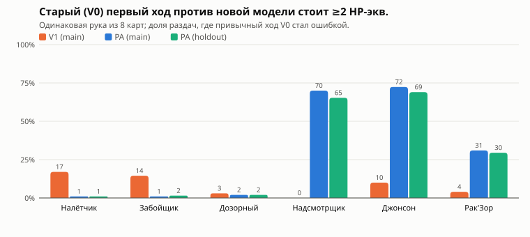
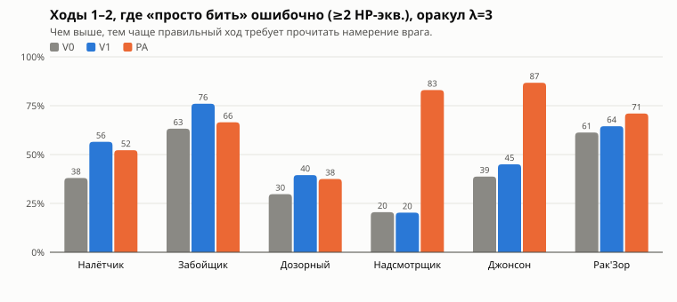
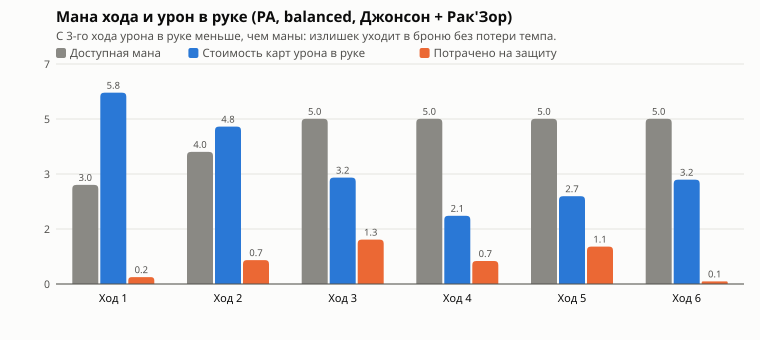
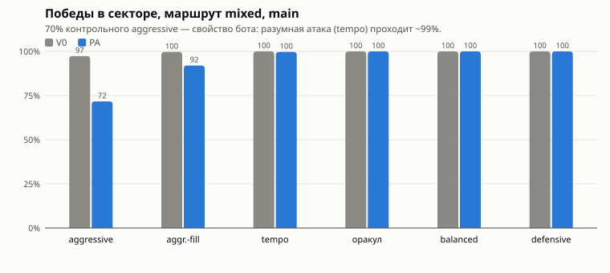
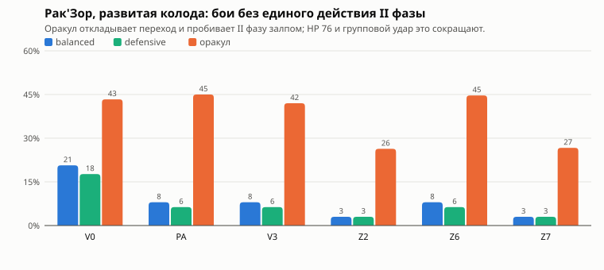
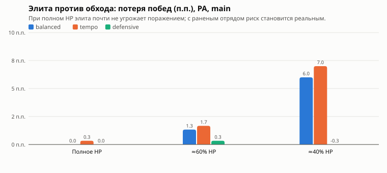

# Sector I Combat Balance v1.1 — Independent Combat Balance Review

20.10.2026. Ревьюер — Claude. Объект ревью — ветка `codex/deadmines-sector-one-balance-v11`, коммит **c344a4e** (база **1afabb3** = `origin/main`). Ревью выполнено в отдельной ветке `claude/deadmines-sector-one-balance-v11-review` от `origin/main`; игровой код, характеристики, карты, интерфейс и результаты Codex не изменялись. Все новые эксперименты — в [пакете ревью](../data/deadmines-sector-one-balance-v11-review/), полные таблицы — в [tables.md](../data/deadmines-sector-one-balance-v11-review/results/tables.md).

PA — моё собственное предложение из прошлого ревью (`0431cf9`). Ниже я его не защищаю: там, где новые данные показывают, что идея была неудачной, это сказано прямо (§B, §6).

## Кратко

| Вопрос | Ответ |
|---|---|
| Технический вердикт | **MERGE READY.** Дефектов реализации не найдено; блокирующих замечаний нет |
| Данные Codex | Воспроизведены: 36/36 ячеек изолированных боёв, полные походы, holdout aggressive 97,00 / 70,33 / 70,00% (V0/PA/V1) |
| PA лучше V1? | **Да, по качеству решений**: у надсмотрщика и Джонсона правильный первый ход V0 становится ошибкой в ~70% раздач (V1 — 0–10%). По давлению на босса V1 сильнее PA |
| PA лучше V3? | V3 ничего не даёт: удар II фазы по Джайне всё равно почти не доходит; отказ Codex от V3 подтверждаю |
| Стала ли игра интереснее? | **Частично.** Начало боёв с надсмотрщиком и Джонсоном — да, заметно. Налётчик/Забойщик/Дозорный — только +1 к урону. II фаза Рак'Зора — почти не работает |
| Defensive слишком сильна? | Это не сила защитных карт, а **структура**: с 3-го хода урона в руке меньше, чем маны, броня не сгорает до удара, а карты не сгорают в руке. Поэтому защита почти бесплатна, а компромисса «скорость ↔ HP» практически нет |
| 70% побед aggressive | **Артефакт бота.** Атакующая исследовательская политика `tempo` проходит PA mixed в 99,7% / 99,3%, оракул — 100% |
| II фаза Рак'Зора | Наступает почти всегда (~3-й ход), «Дрожь штолен» исполняется в 92–97% боёв, но **подготовленный «Летящий молот» по Джайне доходит в 0–3%**; «эксперт» в 31–45% боёв проходит босса без единого действия II фазы |
| Элита | Хорошая основа для экономики риска: ~2 HP при полном здоровье, **−6…−7 п.п. побед** при входе с ~40% HP |
| Рекомендация | **Сохранить PA** для плейтеста. Единственная правка данных, которую я бы внёс до плейтеста, — Рак'Зор **70 → 76 HP** (§F) |

## 1. Что изменено в ветке Codex

`git diff 1afabb3 c344a4e -- src/` затрагивает ровно три файла: `sectorContent.ts` (шесть определений), новый `sectorBalance.test.ts` и одну строку `sectorReview.test.ts` (ожидаемое HP 60/65 → 64/70). Карточные эффекты, улучшения, экономика маны, награды, комнаты, генератор, сохранения, боты, legacy-ростеры и исторические fixtures побайтово не тронуты; `CATALOG_VERSION` legacy остался `e77d6518`, `SECTOR_CATALOG_VERSION` сменился `b29a110 → d4691ce`.

Определения извлечены из коммита как данные ([`config/pa-c344a4e.json`](../data/deadmines-sector-one-balance-v11-review/config/pa-c344a4e.json)) и программно сравнены: они **побайтово совпадают** с конфигурацией V2 Codex и с PA из моего `exp-routes.mjs`; V0 Codex совпадает с каталогом `origin/main`; V1/V3 совпадают с конфигом Codex ([verify.json](../data/deadmines-sector-one-balance-v11-review/results/verify.json)).

| Враг | V0 (1afabb3) | PA (c344a4e) |
|---|---|---|
| Налётчик 32 | М5 → В5 → З2 | М6 → В6 → З3 |
| Забойщик 36 | В6 → М6 → П(В11) | В7 → М7 → П(В12) |
| Дозорный 34 | П(М10) → В5 → З3 | П(М11) → В6 → З3 |
| Надсмотрщик 40 | З6 → П(В12) → М5 | **П(В13) → М6 → З6** |
| Джонсон 60 → 64 | З6 → П(В13) → М6 → З2 | **П(В14) → М7 → З6 → О4 (гл. М)** |
| Рак'Зор 65 → 70 | I: В6 → П(В12) → М5 → З4; II: О4 → П(М10) → В7 → З2 | I: В7 → П(В13) → М6 → З4; II: О5 → П(М11) → В8 → З2 |

`npm test` на c344a4e: 28 файлов, 672 теста, все прошли; `npm run build` — успешно (прежнее предупреждение о чанке >500 kB).

## 2. Методика Codex

| Пункт | Вывод | Основание |
|---|---|---|
| Основная и holdout-выборки | **Корректны**: 42…341 и 1000042…1000341 не пересекаются; planner — первые 60 каждой | Манифесты, мои повторные прогоны |
| Выбор PA до holdout | **Правдоподобно, но не проверяемо** по истории: весь пакет — один коммит, `harnessCommit` во всех манифестах = 1afabb3. Все аргументы в `selection.json` — числа main | P3: в следующий раз коммитить `selection.json` отдельно до запуска holdout |
| Сопоставимость seed | **Да**: одинаковые seed, карта и стартовые ресурсы; DFS 10 002 карт без изменений структуры, отличается только HP узлов | `structure.json`, мои прогоны |
| Скрытые данные | **Не используются**: маршрут — только `publicDungeonNodeView` (тип/связи/HP отряда), боты — публичное намерение, planner — `determinize`. Проверил `dungeonRoutePolicy.ts`, `simulation.mjs`, `balance.ts` | Код |
| Парные сравнения | **Корректны** (одинаковые seed, percentile bootstrap 3000). Поправки на множественные сравнения нет — допустимо для описательных интервалов | `analyze.py` |
| HP при поражениях | Учтены честно: `splitDamage` ограничивает потерю текущим HP, погибший — 0, выживший — фактическое HP. **Но** смешивать поражения со средним HP в «цене пути» нельзя для ботов с поражениями (см. ниже) | `damage.ts`, мой пересчёт |
| Цена элиты | Число **воспроизводится** (balanced 1,95 / 2,13). Ниже показано, что оно сильно зависит от входного HP | §7 |
| Смещение маршрута/артефактов | Mixed берёт элиту только при доле HP > 0,82, поэтому PA уменьшает частоту элит у balanced (0,273 → 0,240 за поход). Codex это оговорил и сделал парные развилки — правильно | `dungeonRoutePolicy.ts` |
| Подтверждают ли данные «улучшение игры» | Codex доказал **рост истощения и цены элиты**, но не измерил изменение решений. Это сделано в §3 | — |

**Методическая проблема отчёта Codex (P2, подтверждена).** Для aggressive в PA «цена элитного пути» указана как 4,43 / 4,19 HP. В тех же парах **победы через элиту 36,0% против 78,0% в обход** (main; holdout 34,7 / 82,0%) — потеря 42–47 п.п. Небольшая «цена в HP» получается потому, что HP выжившего героя проигравшего отряда усредняется вместе с победами. Для политик с поражениями цену надо показывать отдельно: Δ побед и HP только среди побед.

## 3. Стала ли игра тактически интереснее

### Как измерялось

Увеличение потерь HP не доказывает новых решений, поэтому я измерял сами решения тремя независимыми способами:

1. **Оракул** (`scripts/oracle.mjs`) — исследовательский «опытный игрок»: на каждом ходу перебирает **все** различимые последовательности розыгрышей (~80–110 на ход), каждое конечное состояние оценивает rollout'ом до конца боя. Порядок колоды скрыт (`determinize` из planner), а циклы врагов считаются выученными — так играет человек, видевший врага. Критерий: J = потерянное HP + λ·ходы.
2. **Одинаковая рука** (`exp-same-hand.mjs`): для каждого seed стартовые 8 карт в V0 и PA одинаковы. Оракул находит лучший первый ход в обеих моделях; «цена старого плана» — сколько HP-экв. теряет лучший ход V0, сыгранный против PA. 200 раздач × 6 врагов, отдельно main и holdout, 3 детерминизации на линию.
3. **Конкуренция за ману по ходам** (`lib.mjs` → `contest`): сколько маны стоят карты урона в руке и сколько маны доступно.

### Главный результат: одинаковая рука, разный правильный ход

| Враг | Лучший ход другой (PA main) | Старый план стоит ≥ 2 HP-экв.: V1 / PA main / PA holdout | Средняя цена (PA main) | Урон / броня лучшего хода V0 → PA |
|---|---:|---|---:|---|
| Налётчик | 46% | 17 / 1 / 1% | 0,35 | 11,5 → 10,5 / 6,0 → 6,7 |
| Забойщик | 56% | 14 / 1 / 2% | 0,46 | 6,4 → 5,4 / 8,7 → 9,5 |
| Дозорный | 29% | 3 / 2 / 2% | 0,18 | 12,3 → 12,8 / 4,5 → 4,0 |
| **Надсмотрщик** | **96%** | **0 / 70 / 65%** | **3,25** | 11,8 → 6,3 / 4,1 → 7,1 |
| **Джонсон** | **93%** | **10 / 72 / 69%** | **3,76** | 8,8 → 5,8 / 4,9 → 7,2 |
| Рак'Зор | 82% | 4 / 31 / 30% | 1,52 | 7,4 → 7,1 / 7,3 → 6,5 |

Это прямое доказательство того, что PA меняет правильную игру именно у надсмотрщика и Джонсона, и что **V1 этого не делает** (просто +2 к урону почти не меняет лучший ход). Результат одинаков на main и holdout.

**Конкретные состояния** (seed main, одинаковая рука):

- *Надсмотрщик, seed 156.* Рука: Огненный шар, Ледяная стрела, Защитная стойка, Ледяной покров ×2, Парирование, Удар мечом ×2. В V0 враг объявляет «Прячет подбородок: +6 брони» — правильно ударить **до** появления брони: Удар мечом → Ледяная стрела (Уязвимость) → Удар мечом. В PA враг объявляет «Берёт разбег» по Вариану — правильно **не бить вообще**: Стойка → Ледяной покров → Ледяной покров (10 брони Вариану, броня не сгорает до удара), на 2-м ходу добрать ещё 3 и полностью закрыть удар 13. V0-план против PA стоит 7,3 HP-экв.
- *Джонсон, seed 234.* Рука: Огненный шар, Ледяная стрела, Ледяной покров ×2, Прикрыть союзника, Парирование, Удар щитом, Удар мечом. V0 (броня 6 в первом ходу): Ледяная стрела → Огненный шар до его брони. PA (подготовка 14 по Вариану): Ледяной покров ×2, урон держать в руке на 2-й ход. Цена V0-плана — 8,3 HP-экв.
- *Рак'Зор, seed 124.* V0: Покров → Предвидение → Покров (броня впрок под П(В12)); PA: Покров → Парирование → Удар мечом (удар 7 раскрыт сразу, Парирование наносит урон). Цена — 5,3.

### Решения по ходам боя

Оракул λ = 3, 200 боёв на врага. «Жадный ход» — максимум урона сейчас (при равенстве — больше брони), то есть игра без чтения намерения.

| Враг | Жадный ход ошибочен (≥2) на ходах 1–2: V0 → PA | Средняя цена жадного хода V0 → PA | Компромисс «быстрее ↔ безопаснее»: V0 → PA | Порядок важен: V0 → PA | В лучшем ходе есть броня (PA) |
|---|---|---|---|---|---:|
| Налётчик | 38 → 52% | 1,52 → 1,81 | 13 → 15% | 26 → 26% | 99% |
| Забойщик | 63 → 66% | 2,04 → 2,55 | 9 → 9% | 14 → 12% | 98% |
| Дозорный | 30 → 38% | 1,19 → 1,51 | 0 → 0% | 25 → 25% | 91% |
| **Надсмотрщик** | **20 → 83%** | **0,58 → 2,75** | 0 → 7% | 16 → 16% | 96% |
| **Джонсон** | **39 → 87%** | **1,37 → 2,98** | 2 → 6% | 9 → 15% | 94% |
| Рак'Зор | 61 → 71% | 2,48 → 2,69 | 4 → 14% | 14 → 15% | 93% |

На ходах 3+ доля ошибочных жадных ходов у обычных врагов — **0–1%** в обеих моделях: всё, что можно сыграть, играется.

### Оценка по каждому противнику

| Враг | Цикл | Опаснее? | Новые решения | Порядок карт | Противодействие | Отличие от других |
|---|---|---|---|---|---|---|
| Налётчик | Тот же, +1 | Немного (balanced 1,23 → 2,02 HP у Джайны) | Почти нет: V0-план почти всегда верен (1%) | Важен как раньше (~26%) | Понятное | Ранний удар по Джайне — единственный враг, бьющий её первым ходом |
| Забойщик | Тот же, +1 | Немного (balanced 2,59 → 3,96) | Почти нет (1–2%) | Не изменился | Понятное | Чередование В → М → П(В) |
| Дозорный | Тот же, +1 | Нет (≈ 0,6 HP) | Нет | Не изменился | Слишком лёгкое: две карты брони на Джайну | Подготовка по Джайне |
| **Надсмотрщик** | **Новый: удар раньше** | **Да** (balanced 0,07 → 3,09 HP; оракул 0,01 → 0,92) | **Да**: «броня впрок против раннего удара» вместо «бить до его брони» | Не изменился | Есть всегда: 2 хода на 13 брони | **Почти копия Джонсона** (P2, ниже) |
| **Джонсон** | **Новый: удар раньше, О4 по обоим** | **Да** (balanced 0,44 → 4,67; оракул 0,09 → 3,01) | **Да**, самое заметное изменение | Слегка важнее (9 → 15%) | Есть | О4 — единственное отличие от надсмотрщика |
| Рак'Зор | Тот же, +1/+5 HP | Да (balanced 3,46 → 5,67) | Умеренно (I фаза) | Не изменился | Есть | II фаза почти не проявляется (§6) |

**Невозможная защита** не обнаружена: при входе 25/18 все политики, кроме контрольного aggressive, выигрывают 100% изолированных боёв; при 16/12 — tempo/balanced/defensive тоже 100% (1800 боёв на политику); у оракула (полные походы, 600 на модель) поражений нет. Ни один удар PA нельзя назвать «неотражаемым» при разумной игре; скорее наоборот — их слишком легко отразить (§4).

**Итог §3.** PA создала содержательные решения **там, где тяжёлый удар пришёлся на ходы 1–2**: надсмотрщик и Джонсон. У трёх обычных врагов PA — это просто +1 к урону, и правильная игра не изменилась. Значимость порядка карт PA не изменила вовсе: она определяется картами (Уязвимость перед сильным ударом, броня Джайны перед Ледяной стрелой), а не врагами.

**Надсмотрщик и Джонсон — клоны (P2, подтверждено).** В PA: П(В13) → М6 → З6 и П(В14) → М7 → З6 → О4. Отличаются только О4 и 24 HP. Они были клонами и в V0 (З6 → П → М → …); PA сохранил это, переставив оба одинаково. Это не блокирует плейтест, но надо проверить, воспринимают ли люди элиту как «другого врага», а не «надсмотрщика с запасом HP».

## 4. Почему defensive так сильна

### Ответ: это структура, а не сила защитных карт

| Политика | Рак'Зор PA: ходы / потери В+М | Джонсон PA | Доля маны на защиту (босс) |
|---|---|---|---:|
| aggressive | 5,89 / 21,2 | 5,34 / 15,8 | 11% |
| tempo | 5,85 / 10,1 | 5,60 / 11,6 | 31% |
| balanced | 5,73 / 5,7 | 5,43 / 4,7 | 31% |
| defensive | 5,92 / 4,5 | 5,56 / 2,3 | 33% |
| оракул λ=0,5 / 3 / 40 | 5,84 / 3,5 · 5,77 / 4,2 · 5,75 / 5,1 | 5,50 / 2,7 · 5,46 / 3,0 · 5,47 / 3,2 | — |

Разброс темпа между **всеми** политиками — ≤ 0,3 хода, а потерь — в 4–5 раз. Оракул, которому каждый ход стоит 40 HP, не убивает быстрее оракула, которому ход стоит 0,5 HP. **Компромисса «скорость ↔ безопасность» почти нет.** Причина видна по ходам:

| Ход (PA, balanced, Джонсон + Рак'Зор) | 1 | 2 | 3 | 4 | 5 | 6 |
|---|---:|---:|---:|---:|---:|---:|
| Мана | 3 | 4 | 5 | 5 | 5 | 5 |
| Стоимость карт урона в руке | 5,8 | 4,8 | 3,2 | 2,1 | 2,7 | 3,2 |
| Спорных ходов (урон в руке дороже маны) | 90% | 60% | 4% | 2% | 2% | 7% |
| Потрачено на защиту | 0,2 | 0,7 | 1,3 | 0,7 | 1,1 | 0,1 |

1. **Урон ограничен картами, а не маной.** В стартовой колоде 10 карт урона общей стоимостью 14 маны; при доборе 2–3 карты за ход в руку приходит ~1,6–2,3 маны урона за ход, а маны с 3-го хода — 5. С 3-го хода у игрока 2–3 «лишние» маны каждый ход, которые физически нечем потратить на урон.
2. **Броня не сгорает до удара по владельцу.** Лишняя мана в тихий ход (подготовка, броня врага, удар по напарнику) копится до нужного удара. Подготовка даёт два хода на сбор брони.
3. **Рука не сбрасывается.** Карта урона, отложенная ради брони, сыгрывается на следующем ходу из лишней маны. Поэтому защита в спорный ход стоит не «урон», а «задержку урона», которую почти всегда успевают отыграть.

Отсюда: defensive сохраняет больше HP и убивает почти так же быстро, потому что её защита оплачивается маной, которую атакующий всё равно не смог бы потратить. Эффективность защиты на ману сама по себе не завышена (balanced/defensive: 3,6–4,0 поглощённого урона на 1 ману защитных карт, включая гибридную броню; атака — ~6 урона на ману), неиспользованная броня — 3–7 к концу боя с боссом, сгорает при ударе 1–4. Гибриды усиливают эффект: Удар щитом, Парирование на раскрытой атаке и броня Джайны под Ледяную стрелу превращают защиту в урон.

### Что из этого следует

- **Не ослаблять защитные карты.** Это не устранит причину (излишек маны и сохранение брони), а сделает старт зависимым от руки.
- **Компромисс существует только в ходы 1–2.** Именно поэтому PA сработала у надсмотрщика и Джонсона (удар в конце 2-го хода, когда мана ещё спорная) и почти не сработала у Рак'Зора (его тяжёлые удары приходятся на ходы 3+). Это главный практический принцип для будущих врагов: **угроза, которая должна заставить выбирать, должна приходиться на ходы с дефицитом маны**.
- **Минимальные способы поднять ценность агрессии**, по возрастанию цены: (1) ранние угрозы в данных врагов (как PA); (2) враги, у которых «окно» урона закрывается — броня врага `defend/recover` уже есть, её можно ставить сразу после тихих ходов, чтобы отложенный урон стоил больше; (3) награды, повышающие плотность урона в колоде, — со развитием колоды мана начнёт связываться и компромисс появится сам, это надо измерить в секторе II; (4) только если (1)–(3) не помогут — пересмотр добора/экономики или карты-«стоки» лишней маны. Ни одно из этого не требуется для плейтеста сектора I.

## 5. Ограничения aggressive-бота

| PA, mixed, старт 18/8 | Победы main / holdout | Итог HP В / М (main) | Лечились на привале |
|---|---|---|---:|
| aggressive (контроль) | 71,7 / 70,3% | 2,96 / 9,60 | 87% |
| aggressive-fill (Codex) | 92,0% | 6,94 / 12,49 | 83% |
| **tempo (это ревью)** | **99,7 / 99,3%** | **9,94 / 12,59** | 83% |
| balanced | 100 / 100% | 15,53 / 15,75 | 23% |
| defensive | 100 / 100% | 18,98 / 17,42 | 3% |
| оракул λ=3 | 100 / 100% | 19,21 / 17,26 | 3% |

`tempo` — отдельная исследовательская политика (`lib.mjs`), а не игровой бот и не изменение контрольных: тратит всю ману, ранжирует карты по урону на ману с учётом урона гибридов (Парирование на раскрытой атаке, Удар щитом), ставит Уязвимость перед сильным ударом и берёт броню **только** против раскрытого удара, который убьёт или снимет ≥ 60% HP цели, либо когда урона в руке не осталось. Она не превращается в balanced: на боссе теряет 10,1 HP против 5,7 у balanced при том же темпе, предпочитает урон в спорные ходы (на боссе доля маны защиты, потраченной при уроне в руке, — 11% против 41% у balanced) и не строит броню впрок под подготовку (размер подготовки не публичен).

Выводы:

- **70% — свойство контрольного бота**: −3 к оценке защитных карт и порог 0,15 оставляют ману невостребованной (Codex это показал на Парировании). Разумный атакующий проходит сектор практически всегда.
- Но атакующая игра **не бесплатна**: tempo заканчивает с ~22 из 43 HP, лечится на 83% привалов, а при входе в элиту с ~40% HP теряет 7 п.п. побед. Это похоже на целевое ощущение «давление есть, смерть редка».
- Надёжность выводов о целевой сложности: разброс между разумными политиками — **итоговое HP 22–36 из 43** при ~100% побед. Где окажутся люди, данные ботов не говорят; это главный вопрос плейтеста. Опираться на win rate контрольного aggressive нельзя ни в ту, ни в другую сторону.

## 6. Рак'Зор и II фаза

Реальные входы перед боссом: маршрут mixed/balanced проходится до привала, затем **тот же** вход (HP, seed, карта) играется развитой колодой (в среднем 20,4 карты, 1,7 улучшения, 2,7 приобретения, 0,48 предмета) и буквальной стартовой 18/8 без предметов. 300 входов, main; holdout повторяет картину.

| PA, вход mixed/balanced | Переход на ходу | Без единого действия II фазы | Удар II фазы (О5) исполнен | Подготовленный «Летящий молот» дошёл | Действий II фазы | Потери во II фазе В / М |
|---|---:|---:|---:|---:|---:|---|
| развитая · balanced | 2,98 | 8% | 92% | 1% | 1,35 | 0,8 / 0,3 |
| развитая · defensive | 3,11 | 6% | 94% | 1% | 1,40 | 1,1 / 0,1 |
| развитая · tempo | 2,90 | 5% | 95% | 3% | 1,49 | 0,7 / 1,0 |
| **развитая · оракул** | **3,56** | **45%** | 55% | 0% | 0,67 | 0,3 / 0,1 |
| стартовая · balanced | 3,11 | 4% | 96% | 1% | 1,62 | 0,8 / 0,4 |
| стартовая · оракул | 3,74 | 31% | 69% | 0% | 0,94 | 0,3 / 0,1 |
| V0, развитая · balanced | 2,85 | 21% | 79% | 1% | 0,97 | 0,3 / 0,1 |

Ответы на вопросы задания:

1. **Переход** наступает практически в 100% боёв, в среднем на 3-м ходу.
2. **Хотя бы одно действие II фазы** исполняется в 92–97% боёв у ботов, но только в 55–69% у оракула.
3. **Убийство сразу после перехода** (в том же ходу) не встречается; убийство до первого действия II фазы — 4–8% у ботов, 31–45% у оракула.
4. **Отличие II фазы от I**: на деле это один групповой удар О5. Подготовленный удар по Джайне — фирменная механика фазы — доходит в **0–3%** боёв: к 6-му ходу, когда он должен исполниться, босс уже мёртв. II фаза стоит 0,3–1,3 HP.
5. **Смена стратегии**: у оракула — да, но не та, что задумана. Он позже пересекает порог (3,6 против 3,0 хода), накапливает броню и руку, а затем пробивает оставшиеся 35 HP за 1–2 хода. Это законный навык, но он делает II фазу необязательной.
6. **Развитая колода** убивает на ~0,3 хода быстрее и вдвое чаще проходит без II фазы (8% против 4% у balanced). Против босса она не «слишком сильна», но заметно сокращает фазу.
7. **Пробы данных** (только в памяти исследования; та же механика переходов):

| Проба, развитая колода | Ходы balanced | Без II фазы: balanced / оракул | Подготовленный удар дошёл | Потери во II фазе (balanced) |
|---|---:|---|---:|---|
| PA (70 HP) | 5,43 | 8% / 45% | 1% | 0,8 / 0,3 |
| V3 (Codex: В8 по Джайне раньше) | 5,34 | 8% / 42% | 3% | 0,8 / 0,4 |
| Z1: П(М11) первой во II фазе | 5,27 | 6% / 13% | 23% | **0,0 / 0,0** |
| **Z2: HP 76** | 5,89 | **3% / 26%** | 6% | 0,8 / 0,4 |
| Z3: HP 76 + П(М11) первой | 5,73 | 3% / 5% | 54% | **0,0 / 0,0** |
| Z6: П(О7, гл. М) вместо П(М11) | 5,45 | 8% / 45% | 2% | 0,8 / 0,3 |
| Z7: Z6 + HP 76 | 5,90 | 3% / 27% | 6% | 1,0 / 0,4 |

Перестановка подготовки по Джайне в начало II фазы (Z1/Z3) — **плохая идея**: удар доходит, но приходит в ход излишка маны после тихого хода и блокируется полностью (потери Джайны 0,0). Это та же причина, что в §4. Групповой подготовленный удар (Z6) тоже не помогает — он попросту не успевает. Единственный рычаг без движка — **HP**: при 76 HP II фаза у ботов почти гарантирована (1,7–1,9 действия), оракул пропускает её в 26% вместо 45%, ценой +0,4 хода и без роста потерь. Holdout (Z2): 4% / 28%.

**Признание по PA.** II фаза PA — моя конструкция, и она не работает: +5 HP к 65 не дали фазе времени, а подготовка по Джайне в середине фазы физически не успевает. Предлагать сейчас неуязвимость или запрет урона не нужно. Реалистичный путь — HP 76 для плейтеста (§F); полноценная II фаза, по-видимому, требует решения уровня движка для будущих боссов: например, чтобы переход фазы сразу заменял объявленное действие публичным действием новой фазы, или порога, задаваемого данными. Это задача сектора II, не сектора I.

## 7. Элита и реальная стоимость риска

Пары с одной и той же реальной развилки (`elitePrefix` Codex), полный хвост похода. «Вход» — HP, ограниченное сверху 15/11 или 10/7 перед развилкой.

| PA, main | Вход | Потеря в бою | Цена пути HP [95%] | Победы элита / обход | Элита лучше |
|---|---|---:|---|---|---:|
| balanced | полный | 4,60 | 1,95 [1,50; 2,39] | 100 / 100% | 25% |
| balanced | ~60% | 4,60 | 3,59 [3,07; 4,08] | 98,3 / 99,7% | 18% |
| balanced | ~40% | 3,92 | 2,78 [2,36; 3,21] | **90,7 / 96,7%** | 21% |
| defensive | полный / ~40% | 2,0 | 1,08 / 1,36 | 100 / 100 · 96,3 / 96,0% | 24–26% |
| tempo | полный | 9,46 | 4,28 [3,78; 4,77] | 99,7 / 100% | 11% |
| tempo | ~40% | 4,92 | 2,76 | **90,3 / 97,3%** | 17% |
| оракул | полный / ~40% | 2,1–2,3 | 0,90 / 1,55 | 100 / 100 · 98,0 / 99,0% | 27–34% |
| V0 balanced | полный / ~40% | 0,5 | −0,07 / 0,13 | 100 / 100 · 100 / 99,7% | 36–38% |

- **Непосредственная потеря** в бою с Джонсоном выросла с 0,5 до 4,6 HP (balanced), до 9,5 (tempo). **Цена пути** меньше потери, потому что последующий привал частично возвращает её лечением, которое иначе пропало бы, — то есть часть цены элиты фактически платится отказом от улучшения на привале.
- **Предметы** меняют цену: Расклин + Свисток почти вдвое снижают потерю в бою (данные Codex: 2,29 против 4,60). Это нормально для экономики риска.
- **Стартовая колода** — у Джонсона 64 HP бой длится ~5,5 хода, развитие почти не меняет картину до босса.
- **Ценность награды** в остальных боях сектора мала (элитный путь лучше обхода в 11–34% пар; нейтрализованная награда Codex — ~1 HP). Внутри одного сектора это ожидаемо.
- **Разумно обойти элиту**: при раненом отряде (≤ 60% HP) и без защитных предметов — риск поражения 2–7 п.п. при практически нулевой выгоде. При полном HP риск почти нулевой, плата ~1–4 HP.

**Вывод.** PA создаёт правильную форму риска: при полном здоровье элита — умеренная плата HP, при ранении — реальный шанс проиграть поход. Для будущих золотых карт/R2 это подходящая основа: награда должна окупать ~2–4 HP и быть особенно ценной для тех, кто идёт в элиту здоровым. Балансировать элиту под ещё не реализованные награды сейчас не нужно.

## 8. Давление на двух героев

| PA, все 6 врагов, изолированно | Ударов за бой В / М | Входящий урон В / М | Потеря HP В / М |
|---|---|---|---|
| tempo | 1,22 / 0,93 | 11,0 / 6,4 | 6,15 / 2,29 |
| balanced | 1,18 / 0,89 | 10,7 / 5,9 | 2,59 / 0,89 |
| defensive | 1,25 / 1,01 | 11,2 / 6,8 | 1,35 / 0,15 |
| (V0 balanced) | 1,03 / 0,74 | 8,7 / 4,3 | 0,97 / 0,54 |

- Распределение угроз изменилось умеренно: Джайна получает ~55–60% входящего урона Вариана (было ~50%). По ней бьют все шесть врагов, как и в V0; новое — групповой О4 Джонсона с главной целью Джайной.
- **Защищать Джайну приходится часто, но это почти никогда не жертва.** 44–46% её брони даёт «Прикрыть союзника» (карта Вариана, 1 мана — 5 брони), ещё ~17–21% — Ледяной покров. Броня на Джайне одновременно включает +2 к Ледяной стреле. В итоге защита Джайны — скорее атакующий ход, чем компромисс.
- **Вариан по-прежнему единственная реально уязвимая цель**: при входе 16/12 все 122 поражения aggressive в PA (из 1800 боёв) — гибель Вариана, у Джайны 0. В полных походах Codex — 78/81 гибелей Вариана против 7/8 Джайны.
- **Массовые атаки** (О4 Джонсона, О5 босса) опасны только тем, что требуют брони на обоих; при излишке маны это закрывается одной картой «Ледяной покров» + остатком.
- **Предсказуемость** высокая: цель и тип подготовки публичны, удар раскрывается за ход, цели не меняются. Проверки `Announced intent changed` и `Preparation changed target` выполняются в каждом ходу 73 200 изолированных боёв моего цикла (`lib.mjs`) и во всех походах через харнесс Codex — ни одного срабатывания.

Оба героя участвуют в управлении риском **как источники защиты** (Вариан прикрывает, Джайна раздаёт Покров), но как **цели риска** — только Вариан. Это не требует выравнивания урона; в плейтесте надо проверить, ощущается ли угроза Джайне вообще.

## 9. Привал и развитие колоды

По парам Codex «лечение / улучшение / пропуск» в одном и том же состоянии (mixed):

| PA main | Мин. доля HP перед привалом | Итог HP: лечение − улучшение | Победы: лечение − улучшение |
|---|---|---:|---:|
| balanced | < 50% / 50–65% / 65–85% / ≥ 85% | +5,9 / +5,8 / +4,9 / +1,9 | 0 п.п. |
| defensive | 65–85% / ≥ 85% | +4,9 / +1,2 | 0 |
| aggressive | < 50% / 50–65% | +1,4 / +3,5 | **+12 / +15 п.п.** |

- Лечение повышает вероятность победы только у слабой агрессивной игры (+8…+18 п.п. при HP < 65%). У разумной игры оно даёт +5–6 HP финала.
- Улучшение рациональнее лечения внутри сектора I **ни в одном** состоянии: до последнего боя одна улучшенная копия окупает ~0–1 HP. Это ожидаемое следствие короткого среза, а не дефект карт; не предлагаю их усиливать.
- Использование: улучшенные копии разыгрываются в 93–96% походов, приобретённые — в 99–100% (данные Codex). Развитая колода против босса — −0,3 хода и ~0 HP.
- Баланс врагов влияет на кузницу/сокровищницу только косвенно: при PA mixed реже идёт в элиту (0,273 → 0,240), лечение на привале выбирается чаще (1,3 → 23%), что отнимает улучшение. В плейтесте стоит смотреть, воспринимают ли люди привал как реальный выбор, а не «лечись, если ранен».

## 10. Качество реализации и сохранения

| Проверка | Результат |
|---|---|
| Все шесть определений = PA | Да, побайтово (`verify.json`) |
| Порядок действий | Тест «exact disclosed cycle twice» для всех шести; мой цикл боя дал идентичные Codex числа в 36/36 ячейках |
| Порог фазы | Тест 43 → 35 (переход) и 44 → 36 (без перехода); тик Кровотечения тоже переводит фазу. Корректно: `health*2 <= maxHealth` |
| Намерения не меняют цель | Да: тесты + проверки в харнессе Codex и в моём цикле, 0 срабатываний |
| Подготовка раскрывается | Да, тест для Дозорного/надсмотрщика/Джонсона, включая убийство до удара |
| Улучшения и предметы | Тесты Расклина/Свистка на Джонсоне, улучшенные копии в восстановлении боя; в моих походах предметы и улучшения работают |
| Legacy | `CATALOG_VERSION = e77d6518`, настоящий legacy-snapshot читается |
| Fingerprint | `b29a110 → d4691ce` автоматически |
| Старые сохранения | Настоящий V0-snapshot → `IncompatibleSave`, обе записи остаются и экспортируются, откат к backup не происходит |
| Новые сохранения | Тесты восстановления сцен forge/powder-store/treasure/rest/elite/boss/complete и незавершённого боя |
| Исторические тесты | Эталон 427 боёв не тронут; в `sectorReview.test.ts` изменено одно ожидание HP (оправданно) |

Дефектов кода не найдено. Замечания по качеству:

- **P3.** Тест `preserves the prototype encounter health and 18/8, 3-mana opening contract` в `src/game/sectorReview.test.ts:28` теперь утверждает HP PA (64/70). Название вводит в заблуждение — лучше переименовать или перенести проверку HP в `sectorBalance.test.ts`.
- **P3.** После обновления **любой** незавершённый поход сектора I (не только незавершённый бой) блокируется, так как fingerprint покрывает весь каталог. Так задумано, но тестерам нужно заранее сказать: экспорт или новый поход.
- **P3 (скрипты).** Пакет Codex воспроизводим и хорошо задокументирован; harness, `audit.mjs` и inventory — образцовые. Недостатки: смешение HP поражений в «цене пути» для aggressive (§2), отсутствие разницы побед в таблице элиты, единый коммит без фиксации порядка «выбор → holdout».
- Тестов поведения достаточно для данных. Нет теста, который зафиксировал бы **намерение**, например «II фаза босса исполняется хотя бы раз при типичной игре», — это проверяется только симуляцией, и так и должно быть.

## A. Технический вердикт

**MERGE READY.** Реализация ограничена согласованной задачей, проверена тестами и моим независимым воспроизведением. Замечания ниже — документационные или балансные, merge не блокируют.

## B. Независимая оценка PA

- **PA против V1.** PA лучше по главному критерию — изменению решений: у надсмотрщика и Джонсона правильный первый ход меняется в ~70% раздач (V1 — 0–10%), «жадная» игра на ходах 1–2 ошибочна в 83–87% (V1 — 20% и 45%, почти как V0). Зато V1 сильнее PA у трёх обычных врагов (налётчик 56% против 52%, забойщик 76% против 66%) и лучше давит на босса (оракул теряет 5,5 HP против 4,2), но оставляет надсмотрщика и Джонсона бесплатными открытиями (оракул: 0,06 и 0,47 HP). Это аргумент в пользу будущей гибридной версии, но не повод менять выбор перед плейтестом. По итоговому HP и победам aggressive V1 и PA неразличимы.
- **PA против V3.** V3 не решает проблему II фазы (подготовленный удар доходит в 3% против 1%), добавляет Джайне 0,1 HP и ухудшает только слабую агрессию. Отказ подтверждаю.
- **Интереснее ли?** Интереснее **ранняя игра против двух врагов**: появилось реальное чтение намерения («броня впрок» против «удар до брони»). Не интереснее: три обычных врага, порядок карт, II фаза босса. Опаснее стали все.
- **Мои прежние идеи, которые оказались неоптимальными:** (1) II фаза PA; (2) перестановка надсмотрщика сделала его зеркалом Джонсона; (3) прошлое ревью, как и отчёт Codex, опиралось на win rate контрольного aggressive как на меру сложности — это мера слабости бота, а не игры.

## C. Сравнительные данные

Собственные результаты — разделы 3–9 и [tables.md](../data/deadmines-sector-one-balance-v11-review/results/tables.md); воспроизведённые числа Codex отмечены в §0 таблиц. Графики: [одинаковая рука](../data/deadmines-sector-one-balance-v11-review/figures/same-hand-regret.svg), [решения ходов 1–2](../data/deadmines-sector-one-balance-v11-review/figures/greedy-regret-early.svg), [мана по ходам](../data/deadmines-sector-one-balance-v11-review/figures/mana-vs-damage-cards.svg), [победы политик](../data/deadmines-sector-one-balance-v11-review/figures/win-rates-policies.svg), [HP героев](../data/deadmines-sector-one-balance-v11-review/figures/end-hp-policies.svg), [элита](../data/deadmines-sector-one-balance-v11-review/figures/elite-win-delta.svg), [II фаза](../data/deadmines-sector-one-balance-v11-review/figures/boss-phase-two.svg).

| Что | Воспроизведено из Codex | Новое в ревью |
|---|---|---|
| Изолированные бои | 36/36 ячеек V0/PA × 6 × 3 | aggressive-fill, tempo, planner, мана по ходам, броня по героям и картам, вход 16/12 |
| Полные походы | PA mixed/balanced 15,53 / 15,75; holdout aggressive 97,00 / 70,33 / 70,00 | tempo и оракул, main + holdout, 3 маршрута |
| Элита | balanced 1,95 / 2,13 | Δ побед; вход ~60 / ~40% HP; tempo/оракул |
| Босс | 5,73 / 5,77 хода, 1,62 действия II фазы | Реальные входы, стартовая vs развитая колода, пробы Z1–Z7 |
| Решения | — | Оракул: фронтир, цена жадного хода, компромисс, порядок; одинаковая рука |

## D. Найденные проблемы

| # | Приоритет | Статус | Где | Последствия | Предложение |
|---|---|---|---|---|---|
| 1 | P2 | Подтверждена | II фаза `rhahkZor` (`sectorContent.ts`) | Фирменный удар II фазы доходит в 0–3% боёв; эксперт в 31–45% боёв пропускает фазу целиком | HP 70 → 76 для плейтеста; механика уровня движка — для будущих боссов |
| 2 | P2 | Подтверждена | Структура экономики боя (мана 5 с 3-го хода, сохраняемая броня, сохраняемая рука) | Защита почти бесплатна; нет компромисса скорость ↔ HP; defensive и оракул заканчивают сектор с ~36/43 HP | Не ослаблять защиту; угрозы, требующие выбора, — в ходы 1–2; измерить в секторе II на развитых колодах |
| 3 | P2 | Подтверждена | `old-mines-overseer` / `old-mines-johnson` | Два одинаковых цикла; элита может восприниматься как «надсмотрщик с HP» | Проверить в плейтесте; при подтверждении — развести циклы (не сейчас) |
| 4 | P2 | Подтверждена | Отчёт Codex §7, таблица элиты | «Цена 4,43 HP» для aggressive скрывает −42…−47 п.п. побед | Добавить в таблицу Δ побед; HP считать только среди побед |
| 5 | P3 | Подтверждена | Налётчик, Забойщик, Дозорный | PA для них — только +1 к урону; правильная игра не изменилась | Допустимо для обучения; не требует правок |
| 6 | P3 | Гипотеза | Джайна как цель | Все поражения — Вариан; защита Джайны совпадает с атакой (Ледяная стрела) | Проверить ощущение угрозы Джайне в плейтесте |
| 7 | P3 | Подтверждена | `src/game/sectorReview.test.ts:28` | Название теста противоречит проверяемым числам | Переименовать/перенести |
| 8 | P3 | Подтверждена | Процесс | Порядок «выбор → holdout» нельзя проверить по истории | Коммитить `selection.json` до holdout |
| 9 | P3 | Подтверждена | Сохранения | Любой поход сектора I на старой версии блокируется | Предупредить тестеров |

## E. Что стоит менять

1. **Обязательно до merge:** ничего.
2. **Желательно до первого человеческого плейтеста:**
   - Рак'Зор **70 → 76 HP** (единственная правка чисел; ожидаемо: +0,4 хода, действий II фазы 1,35 → 1,72 у balanced, пропуск фазы экспертом 45% → 26%, итоговые потери без изменений). Если владелец хочет плейтест «чистой» PA — оставить 70, но тогда отдельно спросить тестеров, заметили ли они II фазу.
   - Исправить таблицу элиты Codex (проблема 4) и переименовать тест (проблема 7) — можно отдельным маленьким коммитом.
   - Инструкция тестерам о несовместимых сохранениях.
3. **Проверить во время плейтеста:**
   - Меняют ли люди первый ход против надсмотрщика/Джонсона (ожидаемо: броня впрок) и делают ли это без подсказки; путают ли подготовку с немедленной атакой.
   - Различают ли надсмотрщика и Джонсона.
   - Где окажется человек на шкале «tempo ↔ оракул»: итоговое HP ~22 или ~36 из 43. Это решит, нужна ли сектору I дополнительная сложность.
   - Замечают ли II фазу босса; пытаются ли «пробить» её залпом.
   - Воспринимается ли угроза Джайне; чувствуется ли выбор на привале.
   - Решения перед элитой при ранении (ожидаемо: обход при ≤ 60% HP).
4. **Отложить до золотых карт или сектора II:**
   - Ценность наград элиты/R2 под цену 2–4 HP.
   - Повторное измерение компромисса скорость ↔ HP на развитых колодах; при необходимости — добор/экономика или карты-стоки маны.
   - Механика перехода фаз для будущих боссов (смена намерения при переходе или порог из данных).
   - Разведение циклов надсмотрщика и Джонсона.

## F. Рекомендация

**Сохранить PA** как основу сектора I для ближайшего плейтеста. Она единственная из рассмотренных моделей создаёт измеримо новые решения (надсмотрщик, Джонсон), делает элиту платным риском правильной формы и не делает защиту невозможной. Предлагаю ровно одну корректировку данных: **Рак'Зор 76 HP** — она не меняет потери и победы, но даёт II фазе исполниться у обычной игры и вдвое реже позволяет её пропустить.

Окончательный вывод о сложности сектора по ботам сделать нельзя: разумная игра заканчивает сектор с 22–36 HP из 43 при ~100% побед. Проверяемые гипотезы для плейтеста:

- **H1.** Против надсмотрщика и Джонсона ≥ 50% освоенных игроков на 1-м ходу тратят больше маны на броню, чем на урон.
- **H2.** Медианное итоговое HP освоенного игрока ≥ 30 из 43 (то есть ближе к оракулу); если так — сектор I лёгкий, но это допустимо для первого сектора, а давление надо наращивать в секторе II.
- **H3.** Менее половины игроков смогут назвать действие II фазы Рак'Зора, кроме группового удара (при PA 70 HP).
- **H4.** При HP ≤ 60% большинство игроков обходит элиту.

## Воспроизведение

Пакет: [`docs/data/deadmines-sector-one-balance-v11-review/`](../data/deadmines-sector-one-balance-v11-review/README.md). Все эксперименты идут через настоящий движок (`createCampaignBattle`, `playCard`, `endTurn`, транзакции походов Codex), варианты врагов устанавливаются в памяти; движок 1afabb3 и c344a4e побайтово одинаков, различается только `sectorContent.ts`. Сырые строки — `results/raw/*.jsonl.gz`, сводка — `results/summary.json`.
