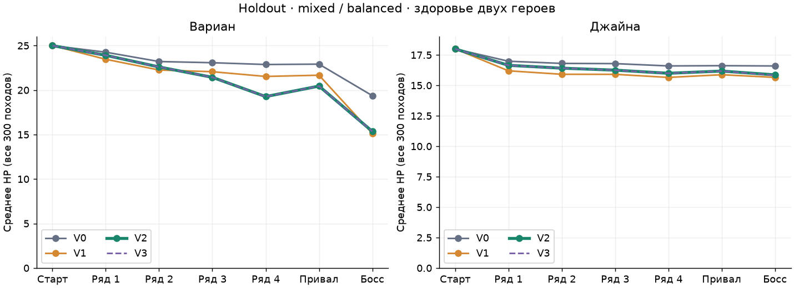
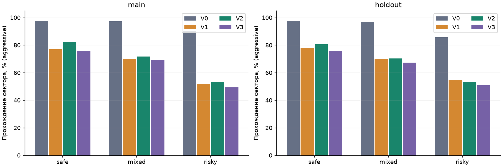
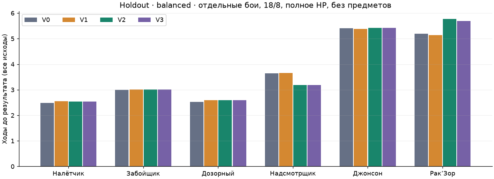
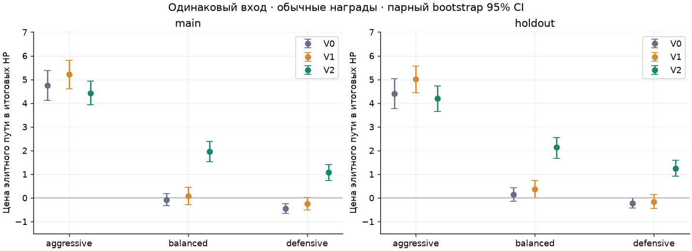
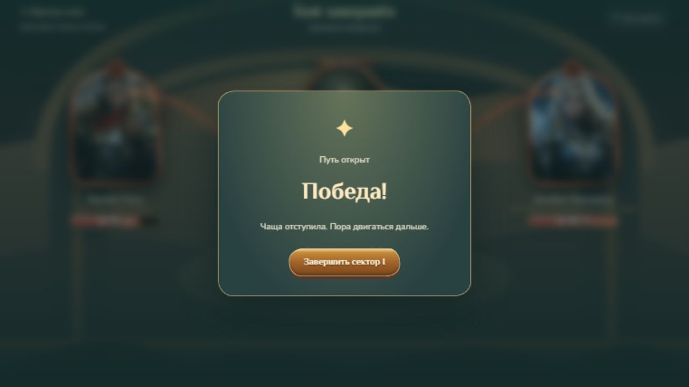

# Deadmines Sector I — Combat Balance v1.1

20.10.2026. Рабочая ветка `codex/deadmines-sector-one-balance-v11`, от актуального `origin/main` **1afabb357dc8b541bfe7bb04b1d4ae6d2b5c0c0f**. Первоначальный сектор `e115e81` и исправления `1afabb3` уже включены в main; зависимости от необъединённой реализации нет. Ревью Claude — **0431cf9**. Его отчёт, скрипты и результаты перенесены из ветки ревью без изменения содержания; сама ветка не сливалась.

**Выбрана и реализована V2 — точная PA из `exp-routes.mjs` Claude.** После [независимого ревью](deadmines-sector-one-balance-v11-review.md) владелец согласовал одну поправку: **Рак'Зор 70 → 76 HP** (v1.1a, §14); остальные параметры PA не менялись. Разделы 1–13 описывают выбор и исследование V2 с 70 HP и оставлены без изменений. Это ограниченная итерация для человеческого плейтеста. Она делает элиту платным риском, раньше предъявляет угрозу надсмотрщика и чаще ставит вопрос лечения. Защита по-прежнему очень сильна, особенно у defensive; равенство стратегий и окончательный баланс приключения не достигнуты и не заявляются.

## 1. Материалы и проверка прежнего исследования

Изучены исходный [отчёт реализации](deadmines-sector-one-v1-report.md), [исправления](deadmines-sector-one-v1-fixes.md), [GDD](spellwhim-gdd-v2.md), [план экспериментов](spellwhim-gdd-v2-experiments.md), [независимое ревью](deadmines-sector-one-v1-review.md), его `harness.mjs`, `sim.mjs`, эксперименты врагов/маршрутов/структуры/событий/валидатора и исходные таблицы в [пакете Claude](../data/deadmines-sector-one-v1-review/).

Отдельные V0-бои на 42…341 воспроизводят числа Claude: Рак'Зор aggressive **5,293** хода и потери **13,35/3,92**, defensive **5,217** и **2,733/0,007**, balanced **5,187** и **3,397/0,067**. Движок и исходные веса ботов не изменились.

Полные старые походы нельзя принять за контроль исправленной версии. `carved-paths-2` исправил повторы вариантов, распределение встреч, sector-prefixed ID и RNG исхода Порохового склада; исправлены фильтры замен. Поэтому новый V0 на той же выборке даёт mixed/aggressive **97,33%**, а старое ревью — **93,7%**. Это не оценка улучшения баланса: исходные маршруты/комнаты уже другие. Все выводы ниже сравнивают новые конфигурации с **актуальным V0**.

В старом исследовании forced-elite направлял поход с самого входа по полным путям карты. Он читал категории/связи, но вход в элиту и обход мог иметь разные префиксы. Новый опыт фиксирует **один и тот же реальный вход перед развилкой**. Старое сравнение остаётся полезным маршрутным наблюдением, но не чистым измерением цены элитного боя.

## 2. Протокол и воспроизводимость

Основная выборка — **42…341**, независимая — **1000042…1000341**. Planner использует первые **60** seed каждого диапазона. Все варианты внутри ячейки используют одинаковые seed, карты, стартовые ресурсы и политики. [Выбор V2](../data/deadmines-sector-one-balance-v11/selection.json) записан **до запуска holdout**; после просмотра holdout параметры не менялись.

Бои проходят исключительно через `createCampaignBattle/restoreDungeonBattle`, `playCard`, `endTurn`; походы — через настоящие транзакции комнат, наград, предметов и привала. Основной старт **18/8**, экономика B, 25/18 HP. Пределы — 30 ходов и 40 розыгрышей за ход; timeout не обнаружены. Эти пределы не заменяют лимиты пользовательской игры. Исследовательские определения меняются только в памяти процесса; игровой каталог был изменён один раз после выбора.

Объём основной матрицы V0–V3, суммарно main+holdout: **43 200** изолированных classic-боёв и **2880** planner-боёв; **21 600** полных classic-походов и **1440** planner-походов. Дополнительно: **194 400** боёв чувствительности V0/V1/V2 (все шесть врагов, три classic-стратегии, шесть условий, 300+300); диагностика aggressive-fill, полные старты 16/8 и 14/8, отсутствие предметов, парные элиты/привалы и пакет развития. Последние опыты содержат повторные воспроизведения и ответвления от checkpoint; их нельзя прибавлять к основному N как независимых игроков.

Чувствительности: 16/12 и 8/6 HP; C16/8 и C14/8 из исходного исследования; пары Расклин Джайне+Свисток Вариану и Полиспаст Вариану+Шкив Джайне при 16/12 HP. C14 содержит Грозовой разряд и иной состав, C16 добавляет к ней Парирование/Предвидение: это **изменение состава и размера**, не чистый эксперимент размера. В игре остаётся буквальная 18/8.

Classic-веса сохранены. Planner — прежний однопошаговый поиск с beam 30, 900 узлами, глубиной 12 и исходным профилем; он не оптимален и в этих боях уступает defensive по сохранению HP. Планировщик не читает порядок колоды, seed, RNG или будущий паттерн. Маршрутный выбор получает только `publicDungeonNodeView`: категории/связи и текущее здоровье. Скрытые встречи, будущие предложения/события и исход риска не используются.

Safe/mixed/risky — прежний `chooseDungeonRouteNode`. Драфт неизменен между V0/V1/V2/V3: первая seeded-карта, пропуск обычной при размере ≥21; элита — первый предложенный предмет в свободный слот, иначе первая карта. Комнаты: прежняя политика Claude, но через исправленные `roomEligibleCards/roomReplacementOptions`; первая допустимая копия и первое предложение. Привал: лечить участника с минимальной долей HP при <65%, иначе улучшить первую допустимую копию. Это воспроизводимые эвристики, не рекомендуемый человеку оптимальный драфт.

Политика неизменна, но её решения могут меняться от HP: например, mixed реже берёт элиту после усиления. Поэтому изолированные бои и парные фиксированные входы служат дополнительным контролем. Отключение предметов заменяет их предложение карточной наградой; это сценарий политики без предметов, а не чистая причинная оценка каждого артефакта.

Проигрыши включены в финальные HP: оставшийся живой герой сохраняет своё фактическое здоровье. Для checkpoint перед боссом одновременно записаны число дошедших, условное среднее среди дошедших и **отдельное zero-imputed среднее по всем**. В основных таблицах используются все походы; нули недошедших не объявляются фактическими потерями HP у босса. Длительность проигранных боёв — время до поражения, а не ускоренная победа.

Парные интервалы — percentile bootstrap **3000** раз, RNG анализа **20261020**. Это описательные 95% интервалы по seed, без поправки на многочисленные разведочные сравнения. Для побед дополнительно дан Wilson: 300/300 означает интервал примерно **98,74–100%**, 60/60 — **93,98–100%**; нулевой bootstrap-разброс побед не доказывает равенства истинных вероятностей.

Скрипты, манифесты, frozen V0/версии, исходные gzip JSONL, [полные таблицы](../data/deadmines-sector-one-balance-v11/tables.md), [парная статистика](../data/deadmines-sector-one-balance-v11/results/paired-statistics.json) и [SHA-256 inventory](../data/deadmines-sector-one-balance-v11/inventory.json) сохранены отдельно от прежних исследований. [Инструкция воспроизведения](../data/deadmines-sector-one-balance-v11/README.md).

## 3. Почему защита выигрывала по HP без потери темпа

Проблема состоит из нескольких причин, а не из одной слишком сильной защитной карты.

1. **Слабое реальное давление.** Надсмотрщик начинал З6 → подготовка: первые два действия не снимали HP. В V0 balanced теряет у него 0,07 HP, у Джонсона 0,44 суммарного HP. У надсмотрщика до опасного удара оставалось целое окно для убийства.
2. **Защита часто совмещается с наступлением.** Парирование наносит урон на раскрытой атаке; Удар щитом добавляет броню и Уязвимость; броня Джайны включает бонус Ледяной стрелы. Потратить ману на защиту может также ускорить урон. Между атаками по разным героям броня напарника сохраняется.
3. **Защита доступна.** В основной раздаче в среднем **3,46** карты с `kind=defense`; дополнительно защищает Удар щитом. Не требуется вытянуть единственную контркарту.
4. **Недорасход aggressive.** У Рак'Зора V0 он тратит **17,04 из 23,47** маны, около **72,6%**, при **5,293** хода. Defensive заканчивает за **5,217**. Он штрафует `kind=defense` на −3 и не играет кандидатов с оценкой ≤0,15. Часть «цены агрессии» — простаивающая мана и отсутствие оценки последовательности «броня Джайне → усиленный удар», а не неизбежная плата за атакующий темп.
5. **Лишняя броня тоже существует.** V0 defensive у босса теряет при исчезновении неиспользованные **3,20** брони за бой и заканчивает ещё с **6,17**; это разные величины, не «столько же предотвращённого урона». Предоставленная броня, реально поглощённый удар и остаток записываются отдельно.

Исследовательская **aggressive-fill** сначала выполняет прежний aggressive; только когда тот останавливается, использует обычный balanced для остатка маны. Это не новый игровой бот и не перенастройка контроля. V0 Рак'Зор: **84,3%** использования маны, потери **8,57/0,08** вместо **13,35/3,92**, темп **5,36** вместо **5,29**. У PA: **82,9%**, потери **10,49/0,19** вместо **16,17/5,01**, темп **5,82** вместо **5,89**. Резкое сохранение HP почти без изменения времени подтверждает неэффективность контрольной агрессии. Однако сама заполненная защита не делает поход тактически разнообразным; это не основание объявить aggressive-fill оптимальным.

Есть конкретно **упущенный атакующий розыгрыш**, а не только отказ от чистой защиты. На раскрытом несмертельном ударе обычное Парирование без бонусов получает `3×1,15 −0,65 −3 = −0,20`; aggressive его отклоняет, хотя за 1 ману оно дало бы 3 урона и 3 брони. Воспроизводимая fixture с одной такой картой и 3 маной подтверждена движком в `verification.json`: aggressive пасует, balanced играет. В V0 у босса в среднем **1,89 маны за бой** оставлено на ходах с доступной картой активного урона; aggressive-fill снижает эту метрику до нуля. Поэтому win rate исходного aggressive нельзя выдавать за потолок умелой агрессивной игры.

В исходной PA на отдельных боях лучше сохраняет HP defensive; planner часто быстрее, но тратит больше здоровья. **Равенства эффективности стратегий получить не удалось.** Ослаблять карты ради устранения такого результата в этой итерации было бы подменой задачи. Веса контрольных политик, карты, мана и добор не менялись.

## 4. Сравниваемые модели

| Модель | Изменения | Тактический эффект / риск | Реализация |
|---|---|---|---|
| V0 | Текущий сектор `1afabb3` | Слишком безопасная элита, два тихих открытия у громилы; здоровье мало ценно для защиты | Контроль |
| V1 | +2 к одиночному удару, +1 к каждому массовому; HP/броня/циклы прежние | Больше истощения, прежние окна; элитный путь для balanced почти не дорожает | Простые данные |
| **V2 PA** | +1 к одиночным/массовым ударам; налётчик З3; ранняя подготовка громилы/Джонсона; Джонсон 64 и О4 вместо З2; Рак'Зор 70 | Сильный раскрытый удар раньше, после него другой адресат; добровольная элита ощутимо дороже; привычные контрмеры работают | Только шесть определений |
| V3 | PA, но во II фазе босса В8 переносится перед подготовкой и меняет цель на Мага | Ещё один адресный удар до тихого окна. Для balanced выигрыш по Mage-pressure мал, слабый aggressive чаще погибает | Только один цикл; отклонён |

PA взята буквально из скрипта Claude: в частности, у налётчика броня 3, а у Джонсона последнее действие — **массовая атака 4**, а не лечение/броня 4. V1 и PA не складывались. Новые механики, порог фаз и правила исчезновения брони не вводились.

## 5. Главные результаты полных походов

Mixed, старт 18/8. Каждая цифра — **main / holdout**, N=300/300.

| Модель | Победы aggressive % | Итог HP balanced В / М (main) | Итог HP balanced В / М (holdout) | Победы balanced / defensive | Изолированный Рак'Зор balanced, ходы main/holdout |
|---|---:|---|---|---|---:|
| V0 | 97,33 / 97,00 | 19,69 / 16,62 | 19,37 / 16,60 | 100% / 100% | 5,19 / 5,19 |
| V1 | 70,00 / 70,00 | 15,46 / 15,31 | 15,13 / 15,66 | 100% / 100% | 5,15 / 5,14 |
| **V2** | **71,67 / 70,33** | **15,53 / 15,75** | **15,36 / 15,87** | **100% / 100%** | **5,73 / 5,77** |
| V3 | 69,33 / 67,33 | 15,53 / 15,68 | 15,36 / 15,83 | 100% / 100% | См. полные таблицы |

V2 относительно V0, mixed/balanced: парное изменение суммарного итогового HP **−5,03 [−5,38; −4,71]** main и **−4,75 [−5,07; −4,41]** holdout. Aggressive теряет **25,67 [20,33; 31,33]** и **26,67 [21,66; 32,33]** процентных пункта прохождения. Главный эффект устойчив; малую разницу V1/V2 в 1–2 п.п. побед считать доказанным преимуществом нельзя.

Для PA aggressive safe/mixed/risky: **82,33/71,67/53,33%** main, **80,67/70,33/53,33%** holdout. Это ожидаемое отличие политик риска, а не требование выровнять их шансы. Balanced на всех трёх сохраняет 100% в выборках. В mixed defensive PA заканчивает **18,98/17,42** main и **18,96/17,49** holdout; planner (60/60) — **13,58/16,37** и **12,92/16,07**, 100% побед.

PA mixed/aggressive: main — 85 поражений (77 у Рак'Зора, 2 у Забойщика, 3 у надсмотрщика, 3 у Дозорного); holdout — 89 (78/3/7/1 соответственно). Погибает Вариан в **78/81** случаях main/holdout, Джайна — в **7/8**. Перекос в потерях Воина сохраняется. Сводки по каждому врагу показывают своё N, обе потери HP, карты и ману; это показатели **состоявшихся встреч**, а не исправленные на survival средние всего похода.

Чистое суммарное истощение PA mixed/balanced после привала — около **27%** стартовых 43 HP, planner — **30–33%**, defensive — только **15–16%**. Ориентир 30–40% для всей грамотной игры не достигнут; повышать числа ради него не стали.

## 6. Роли врагов и конкретные игровые изменения

Обозначения: В/М — Воин/Маг, О — оба. Подготовка занимает тихое действие, затем удар объявляется точно на следующий ход. Основная цель группового удара фиксирована данными.

| Враг | HP V0 → PA | Новый цикл | Проверяемая задача |
|---|---:|---|---|
| Шахтёр-налётчик | 32 → 32 | М6 → В6 → З3 | Сразу заметить адресата, прикрыть раннюю угрозу, сохранить наступление; не экзамен на редкую карту |
| Забойщик | 36 → 36 | В7 → М7 → П(В12) | Чередование защиты двух участников; подготовить следующий удар, не расходовать всю броню на первого |
| Дозорный Братства | 34 → 34 | П(М11) → В6 → восстановление З3 | Два окна ответа на прицельный удар: подготовить броню либо ускорить убийство, затем увидеть точный размер |
| Громила-надсмотрщик | 40 → 40 | П(В13) → М6 → З6 | Сначала опасный молот, затем напарник и защитное окно; больше не получает два бесплатных открытия подряд |
| Шахтёр Джонсон | 60 → 64 | П(В14) → М7 → З6 → О4 (главная М) | Цена добровольного риска; после тяжёлого блока переключить защиту и пережить массовый удар |
| Рак'Зор | 65 → 70 | I: В7 → П(В13) → М6 → З4; II: О5 (главная В) → П(М11) → В8 → З2 | Сохранить здоровье двух героев, использовать тихие окна и сформированную колоду |

Порог босса остаётся половиной maxHP: **35** вместо 32,5 из-за нового HP. Уже объявленная подготовка/атака продолжает исполняться. На базовой колоде main среднее число **исполненных действий** фазы II у balanced выросло **1,14→1,62** (holdout PA 1,68); сюда входят и тихие подготовки, это не число ударов. Число побед на объявленной подготовке у босса уменьшается примерно **0,68→0,34** на бой. Фаза II участвует заметнее, но часть её поздних действий всё ещё не успевает исполниться.

Свежие обычные бои выигрываются всеми classic и planner на обеих выборках. Это сохраняет мягкость первого входа. Потери Mage у balanced в полном mixed-походе увеличиваются с 1,38 до 2,25 main и с 1,40 до 2,13 holdout. Это умеренное изменение, не устранение всей безопасности Джайны у defensive. У неё теперь есть реальные адресные/массовые угрозы и отдельная проверка подготовки 11, но дальнейшую потребность в её защите должен подтвердить плейтест.

## 7. Цена элиты: бой, маршрут и награда

Перед выбором третьего ряда найден реальный публичный fork с элитой и безопасной услугой. Первые две комнаты проходятся один раз. Затем обе ветви получают **одинаковые HP, копии/уровни, предметы и seed похода**. Встречи и battle seed по разным узлам различаются штатно. После развилки действует та же mixed-политика. В каждой основной ячейке найдено 300 подходящих fork из 300; prefix-поражения и недоступные fork также предусмотрены и записаны, не отфильтровываются как успешные походы.

Прямая цена — фактические потери HP в бою с Джонсоном. Маршрутная цена — terminal HP безопасной ветви минус terminal HP элитной, включая все дальнейшие бои, лечение и поражения. Это сравнение с услугой, не с воображаемым обычным врагом. Для нейтрального развития безопасная услуга пропускается, а результат настоящей элитной награды **нейтрализуется исследовательским вмешательством**. В UI элитного skip нет: скрипт законно принимает карту, затем убирает только приобретение в этой контрфактической ветви; игровые правила не меняются.

| Модель / бот, без предметов на входе | Потеря самого боя main/holdout | Цена маршрута с наградой main/holdout |
|---|---:|---:|
| V0 balanced | 0,50 / 0,53 | −0,07 / 0,15 |
| V1 balanced | 1,30 / 1,33 | 0,07 / 0,36 |
| **V2 balanced** | **4,60 / 4,73** | **1,95 / 2,13** |
| V2 defensive | 2,01 / 2,05 | 1,08 / 1,25 |
| V2 aggressive | 16,53 / 17,09 | 4,43 / 4,19 |

PA balanced маршрутная цена: **1,95 [1,53; 2,38]** main, **2,13 [1,68; 2,55]** holdout. При нейтральном развитии — **2,49/2,70** HP. Отдельная выгода обычной награды элиты в её собственной ветви — **1,05/1,07** итогового HP; разница между 4,60 прямой потери и 1,95 конечной цены также включает привал, альтернативную услугу и последующие бои, поэтому её нельзя целиком назвать силой награды.

Пары с двумя типичными предметными комплектами и отдельный опыт вообще без предметов сохранены в данных. PA balanced с Расклином+Свистком: прямая потеря **2,29/2,25**, цена пути **1,57/1,63**; с Полиспастом+Шкивом — **4,80/4,83** и **2,24/2,46**. Вообще без предметов, включая последующие награды, цена пути **2,29/2,88**; первая карточная награда элиты здесь даёт **−0,09/−0,46** HP относительно её нейтрализации — слабый фиксированный драфт способен разбавить колоду. Сильные предметы меняют цену риска; 2 HP — не гарантированная плата за каждого Джонсона. Для V3 отдельная цена элитного маршрута не оценивалась: вариант отклонён по скринингу босса/полных походов, его новое прицельное действие не переносится в игру. R2/золото и ценность инвестиций на секторах II–III этим опытом не проверены.

## 8. Привал: где лечение уже имеет смысл

При той же эвристике <65% mixed/balanced выбирает лечение **1,33→23,33%** main, **1,00→22,67%** holdout; остальные походы этой стратегии выбирают upgrade. В risky/balanced PA main лечение — **30,33%**. Частота не задавалась целью и не подгонялась. Defensive всё ещё в основном улучшает: mixed PA **3,33%** лечения на обеих выборках.

В одном и том же достигнутом состоянии перед привалом отдельно проиграны heal / upgrade / skip; выбор не получал доступа к будущему боевому seed/руке. Это диагностические вмешательства после факта, а не бот с предвидением. Погибшие до привала включены в проценты побед всех 300 походов.

Для PA mixed/aggressive: **71,67/60,33/59,67%** main и **70,67/62,00/61,67%** holdout (heal/upgrade/skip). Лечение заметно повышает выживаемость, а пройти без него возможно. В holdout balanced: **100/99,33/99,33%** — два состояния, где отказ от лечения приводит к поражению, и адаптивная политика их переживает. Это небольшой хвост, не доказанный норматив.

Большинство здоровых balanced/defensive состояний допускает оба решения. Upgrade даёт небольшое ускорение следующих розыгрышей и постоянное изменение копии; heal сохраняет больше итогового HP. До одного оставшегося босса эффект одной улучшенной копии мал. Не доказано, что короткий сектор делает оба варианта одинаково ценными.

У aggressive встречается не монотонный ответ на здоровье: в PA holdout лечение превращает 55 проигрышей skip в победы, но также 28 его побед — в проигрыши. Причина — переключение эвристики по **lethalThreat**, а не вред от лечения в движке. Нельзя интерпретировать эти 28 как плохие игровые состояния с большим HP; они показывают ограничение бота. Полные числа «помогает/мешает» оставлены в таблицах.

Размер лечения остаётся **до 6 HP одному герою**; экономика здоровья A/B/C и новые источники лечения не менялись.

## 9. Предметы, колоды и раннее развитие

Все шесть противников проверены с C14/8, C16/8 и двумя предметными парами, а также при 16/12 и 8/6 HP. Подробные клетки в `*-sensitivity-*.json`: малые колоды ускоряют часть боёв, но одновременно меняют состав. Они не переносятся в игру. Предметы могут приблизить безопасную защитную игру; повышения давления недостаточно, чтобы сделать пары Полиспаст+Шкив или Расклин+Свисток несущественными. Слоты/триггеры/числа предметов не менялись.

Полные дополнительные походы сравнивают V0/PA на 14/8, 16/8 и 18/8 без предметов, все три маршрута/бота, 300+300. Их иной драфт при отказе от предмета обозначен отдельно. Никакая компактная колода не нужна для прохождения сектора базовой 18/8.

Считаются сыгранные улучшенные и приобретённые копии, а не только их наличие в финальной колоде; карты адресуются постоянным instanceId. Дополнительный контроль раннего развития: из **того же pre-rest HP/seed** проиграть остаток без лечения с развитой колодой/предметами либо с буквальной стартовой колодой без улучшений/предметов. Это вмешательство в **пакет**, не причинная оценка каждой карты/комнаты; цена HP уже обработанных событий остаётся одинаковой.

PA mixed/balanced за полный поход: **35,99/36,56** сыгранных карт, **47,26/47,73** потраченной из **56,06/56,85** доступной маны (main/holdout). Улучшенные копии применяются хотя бы раз в **92,67/95,67%** походов, в среднем **2,30/2,44** розыгрыша; приобретённые — в **100/99,67%**, **3,32/3,37** розыгрыша. Уменьшение частоты улучшения на привале не равно отсутствию эффекта развития: часть копий уже улучшена событием/кузницей.

Main PA balanced: развитый пакет даёт **5,54** хода босса против **5,73**, итоговое HP отряда **29,89** против **29,99**, победы 100/100%. У defensive — **5,62** против **5,86**, HP **36,18** против **35,79**. То есть развитие применяется, немного ускоряет, но ещё не создаёт большого переворота силы за один сектор. У aggressive пакет может ухудшить результат из-за неудачного первого драфта/разбавления колоды; преимущество полученной карты не предполагается автоматически. Для оценки долгосрочного развития нужны следующие сектора и более содержательный драфтер.

## 10. Почему выбрана PA

V1 и PA близки по итоговому HP и прохождению aggressive. Решающий аргумент PA — **заметная цена именно элитного пути и устранение безопасного открытия громилы**, при сохранении коротких обычных боёв. V1 этого не даёт, хотя повышает общий ущерб. PA сохраняет человечески понятные действия и существующие ответы; стоимость реализации — определения данных и тесты.

V3 повышает риск слабой агрессии, но уменьшает HP Джайны mixed/balanced лишь примерно ещё на **0,07** main / **0,04** holdout. Этого недостаточно для ещё одного игрового изменения. Никакой комбинации «все усиления V1 плюс PA» нет. На holdout выбор PA сохранён; отклонённый вариант оставлен только в исследовательском конфиге.

Что осталось открытым: defensive сохраняет больше здоровья без достаточной цены темпа; Джайна у него почти не истощается; поздняя часть II фазы часто не исполняется; у босса всё ещё есть безопасная подготовка, которую можно обернуть в убийство. Это хороший следующий набор вопросов для людей, а не основание немедленно ослабить карты или вводить новый статус.

## 11. Сохранения и границы реализации

Из игровых файлов изменён **только `sectorContent.ts`**. Технически обновлено старое ожидание HP 60/65→64/70 в `sectorReview.test.ts`; исходные 60/65 сохранены в frozen V0. Добавлен `sectorBalance.test.ts`.

Fingerprint сектора автоматически меняется **`b29a110` → `d4691ce`** (после поправки v1.1a — **`aab46150`**, §14), потому что включает все определения HP/паттернов. **`RULES_VERSION = combat-upgrades-1`** сохранена осознанно: семантика боевых глаголов, очередность урона, фазы и информация не менялись. Новый номер общих правил был бы ложным изменением контракта legacy. Генератор **carved-paths-2**, room rules **sector-rooms-2:a7984ea9** и legacy catalogue **e77d6518** прежние.

Подлинный V0 snapshot незавершённого боя теперь даёт `IncompatibleSave` до попытки восстановить врага. Store блокирует автоматический откат даже к совместимому backup; **обе исходные записи** сохраняются и экспортируются. Не создаётся карта с новыми HP поверх старого похода. Миграция не вводилась.

Новые снимки восстанавливают ту же сохранённую карту, назначения, пройденный маршрут, незавершённую комнату/предложения, ledger, награду и улучшенные instanceId. Во время боя восстанавливается **начало того же боя**, как и прежде, а не оплаченный pending или середина анимации. Двойное получение награды/услуги после reload отклоняется. Настоящий legacy snapshot от `1afabb3` читается прежним путём; fingerprint не изменился.

Аудит сохранил SHA-256 защищённых файлов и повторил **567** строк основных боёв/походов на финальном harness: совпали исход, HP, ходы, мана, блок и действия II фазы. [Результат](../data/deadmines-sector-one-balance-v11/results/verification.json). При проверке обнаружен и исправлен пропуск ID врага в маршрутной телеметрии: public-node намеренно не содержит encounterId, поэтому метрика должна читать уже раскрытый узел **после входа**. Все затронутые прогоны повторены; `replay-*.json` фиксируют неизменность прежних числовых сводок, кроме появления корректных групп `byEnemy`. Выбор/holdout не перенастраивались. `battle.ts`, карты/улучшения, экономика, боты, карта/комнаты/награды, предметы, сохранения, legacy ростеры и исторические fixtures побайтово не менялись относительно base.

## 12. Автоматическая и браузерная проверка

Новый набор покрывает явные циклы всех шести встреч дважды, урон/адресатов, раскрытие подготовки, убийство до удара, ровный порог 35 и границу 36, сохранение старого намерения на переходе, массовый удар с разной бронёй двух героев, Кровотечение/Уязвимость, Расклин/Свисток, несовместимый старый snapshot и экспорт, текущий бой с улучшенными копиями, карту/комнаты/ledger/награды/итог и однократность операций. Старые проверки остальных предметов/боевых эффектов входят в полный suite.

`npm test`: **28 файлов, 672 теста**. Исторический эталон **427 боёв** прошёл без перезаписи. `npm run scenarios -- 42`: контрольные сценарии прошли. `npm run build`: TypeScript/Vue и production build прошли; прежнее предупреждение Vite о чанке >500 kB сохраняется.

Независимая структурная проверка: **10 002** карты (0…9999 и две uint32-границы), DFS oracle из предыдущих исправлений плюс штатный валидатор. **0** нарушений, подмен или изменённых графов/назначений V0↔PA; изменилось только HP соответствующих узлов. Прежние структурные результаты не перезаписаны. [Новый прогон](../data/deadmines-sector-one-balance-v11/results/structure.json).

Браузерная проверка — встроенный браузер Codex, **1280×720 и 1920×1080**, изолированное QA-хранилище. Промежуточные сцены достигнуты существующим `createSectorScene` через настоящие предыдущие бои/награды, без подстановки побед/HP. Затем через «Начать новый поход → Сектор I» создан **новый поход с начала**, который полностью пройден кликами по видимым картам/комнатам. В этом полном проходе headless-бот не играл ни один бой. Пользовательское обычное хранилище не затронуто; временный viewport override снят.

| Сценарий | Фактически проверено |
|---|---|
| Джонсон, QA seed 42 | 64 HP; подготовка с `?` по Воину; раскрытие 14; после удара В25→11; М7 оставляет Джайне 11; затем З6 и О4: оба 11→7. Раздельные цели/лучи и массовая анимация видны. Полный бой с элитой вручную не доигран |
| Reload незавершённой элиты | 64 HP, исходные 25/18, рука и 3 маны восстановлены, бой снова на подготовке; потери незавершённого боя не переносятся |
| Рак'Зор, отдельный QA-вход | Весь бой вручную, **7 ходов**, итог 18/18 HP; обе фазы; переход через половину HP сохраняет старый удар; О5 поглощается раздельной бронёй, подготовка по Джайне раскрывается и удар поглощается её 11 брони; настоящее `sector-complete` |
| Полный новый сектор, seed **1516863682** | 18/8 → Дозорный → Забытая кузница → кузница → Забойщик → привал → Рак'Зор. Рассекающий удар получен и улучшен за 3 HP Вариана, Ледяная стрела улучшена в кузнице, Грозовой разряд получен после Забойщика, Парирование улучшено вместо лечения. Все бои и решения — UI-клики |
| Обычные бои нового похода | Дозорный 34, подготовка по Джайне и блок 11; Забойщик 36, В7→М7, фактическая потеря Варианом 1 HP, применение улучшенных карт/Уязвимости/Кровотечения; победный тик останавливает удар 12 |
| Босс полного похода | Вход 21/18, 20 карт, 3 улучшения, без предметов. Победа за **4 хода**, итог **19/18**. Тик переводит фазу, старый удар сохраняется; два принятых HP за дополнительный урон позволяют добить двумя Огненными шарами до О5 |
| Итог / reload | И на 1280×720, и на 1920×1080 итог, 20 карт, маршрут/журнал/HP сохраняются; после reload предлагается «Посмотреть итог», прежние комнаты не открываются заново |

Развитый удачный вход всё ещё позволяет убить Рак'Зора **до первого исполнения II фазы**: телеграф О5 появился, но игрок успел добить. Это важное ограничение, которое один средний показатель 5,7 хода скрыл бы. Блокировать такое добивание искусственной неуязвимостью не стали. Один проход агента через UI — проверка работоспособности и пример решений; он **не заменяет человеческий плейтест** и не измеряет время освоенного игрока.

Снимки — [каталог](../screenshots/sector-one-balance-v11/). Переход phase II, Джонсон и итоги сохранены отдельно. Блокировка старого fingerprint/экспорт проверены программно; скачивание старого сейва через UI отдельно не воспроизводилось. Настольная Tauri-сборка, узкие окна и 2560×1440 в этой задаче не проверялись.

## 13. Что проверять людьми дальше

1. Начинающий: замечает ли цель первого удара и может ли ответить без идеальной руки; не путает ли подготовку с немедленной атакой.
2. Опытный: меняет ли порядок карт при ранней подготовке громилы/Джонсона, когда предпочитает добить вместо добавления брони.
3. Перед элитой: принимает ли ожидаемую цену примерно 2 HP маршрута ради нынешнего приза; отдельно сравнить раненые состояния и занятые слоты.
4. Привал: какие реальные HP/карты побуждают лечиться; получается ли объяснить человеку цену отказа до босса без знания следующей руки.
5. Рак'Зор: узнаёт ли II фазу, планирует ли защиту Джайны и считает ли 5–7 ходов достаточно содержательными.

Нужны повторные освоенные попытки людей, а не калибровка под один win rate бота. R2/золото, новые предметы, экономика лечения, новые механики и сектора II/III остаются отдельными задачами. Общий баланс трёхсекторного приключения не завершён.

## 14. Поправка v1.1a: Рак'Зор 76 HP

20.10.2026, по итогам [независимого ревью](deadmines-sector-one-balance-v11-review.md) (§6, пробы Z2). Проблема: подготовленный удар II фазы почти никогда не успевал исполниться, а «экспертный» оракул ревью в 31–45% боёв убивал босса раньше первого действия II фазы. Из проверенных правок данных помогло только HP; перестановки II фазы и подготовленный групповой удар не помогли. Изменено **только** `maxHealth` Рак'Зора: 70 → 76, порог фазы — 38 вместо 35. Циклы обеих фаз, остальные пять врагов, карты, экономика, награды и правила не менялись; `RULES_VERSION`, legacy-каталог, генератор и правила комнат прежние. Секторный fingerprint автоматически сменился **`d4691ce` → `aab46150`**: сохранения v1.1 с 70 HP блокируются так же, как прежние, с экспортом исходных записей.

Подтверждение на фактическом каталоге ([`compare.mjs`](../data/deadmines-sector-one-balance-v11-rakzor76/compare.mjs), [результаты](../data/deadmines-sector-one-balance-v11-rakzor76/results.json)): прежние политики и харнесс Codex, те же seed main / holdout по 300. Строки 70 HP точно воспроизводят числа V2 выше.

| Показатель (main / holdout) | 70 HP | 76 HP |
|---|---|---|
| Изолированный Рак'Зор, balanced: ходы | 5,73 / 5,77 | 6,08 / 6,09 |
| То же: действий II фазы | 1,62 / 1,68 | 1,84 / 1,88 |
| То же: потери В / М (main) | 5,29 / 0,38 | 5,37 / 0,33 |
| Изолированный, defensive: ходы / действий II фазы | 5,92 / 1,71 | 6,17 / 1,84 |
| Изолированный, aggressive: потери В / М (main) | 16,17 / 5,01 | 16,15 / 5,34 |
| Mixed поход, balanced: итог HP В / М | 15,53 / 15,75 · 15,36 / 15,87 | 15,51 / 15,70 · 15,26 / 15,82 |
| Mixed поход, defensive: итог HP В / М (main) | 18,98 / 17,42 | 19,03 / 17,42 |
| Mixed поход, aggressive: победы | 71,67 / 70,33% | 69,67 / 69,33% |
| Mixed поход, balanced: ходы босса | 5,43 / 5,40 | 5,89 / 5,85 |

Из ревью (реальные входы перед боссом, развитая колода, main): у balanced бои без единого действия II фазы 8% → 3%, у оракула 45% → 26% (holdout 43% → 28%); подготовленный удар II фазы доходит в 1% → 6% боёв. Итог: бой длиннее примерно на 0,4 хода, II фаза почти всегда успевает проявиться у обычной игры, а итоговое здоровье и победы balanced/defensive не меняются; у контрольного aggressive победы ниже на 1–2 п.п. (в пределах разброса). Полноценное исполнение подготовленного удара II фазы этой поправкой не достигается — это вопрос плейтеста и будущих механик перехода фаз.

Исследовательские скрипты и результаты §1–13 не перезаписывались: `scripts/audit.mjs` намеренно сверяет игру с выбранной V2 (70 HP) и после поправки отвергнет каталог — для текущего каталога используйте `compare.mjs`. Тесты: порог 76/2 (46 → 38 переводит фазу, 47 → 39 — нет), тик Кровотечения 39 → 38, HP 76 в контракте секторных HP и отличие fingerprint от `b29a110` и `d4691ce`.

