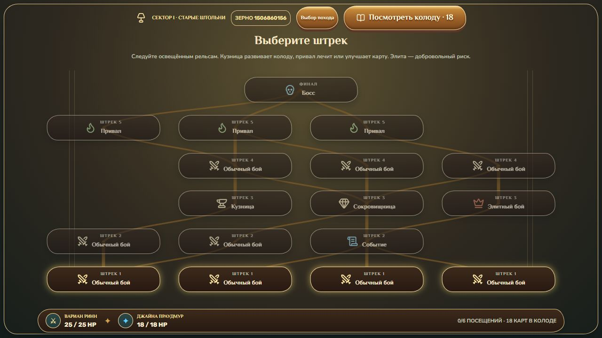

# Старые штольни и Map Generator v1

20.10.2026. Основа — обновлённый `origin/main`, `b404aa82f9f51ca8fc023fa2a71388024eed8b9d`. Рабочая ветка — `codex/deadmines-sector-one-v1`. Это вертикальный срез **одного** сектора, с игровым стартом 18/8, экономикой B и прежними 23 картами/улучшениями. Сектора II/III, переходы между ними, золото, R2 и полное прохождение Мёртвых копей не реализованы.

## Игровой результат

В начальном экране можно выбрать «Сектор I — Старые штольни» или старый контрольный поход из семи посещений. Общие `DungeonRunState`, движок боя, постоянные экземпляры, награды, экипировка, привал и локальное хранилище обслуживают оба режима. Старые функции `createDungeonMap/createDungeonRun`, ростеры v0.9/v1.0, исследования и боевые эталоны сохранены.

У сектора пять рядов выбора и Рак'Зор. Игрок посещает ровно шесть комнат: начальный бой → бой/событие → развитие/элита → бой → привал → босс. Получается 2–3 обычных боя, 0–1 элита, всего 3–4 боя с боссом. В рамках ограничения GDD бой во втором ряду и элита в третьем не могут оказаться на одном пути. Элита доступна как добровольное ответвление.

На карте видны категории, соединения, доступность, пройденные рёбра, сектор, HP и размер колоды; обзор колоды доступен прямо с карты. Имя/HP/поведение скрытой встречи и предложения комнат не передаются ни в подписи/aria, ни в `publicDungeonNodeView`. Босс отмечен категорией «Босс»; его сюжетное имя раскрыто описанием режима.

После победы над Рак'Зором сохраняется **`sector-complete`**, отдельно от `victory` legacy-кампании. Новой боссовой награды нет. Экран «Сектор I пройден — Старые штольни» показывает обоих героев, размер и обзор колоды, количество боёв, последовательность комнат и журнал решений с полученными/улучшенными картами. Можно закончить тестовый поход и выбрать новый режим.

## Архитектура генератора

`src/game/dungeonGenerator.ts` содержит конфигурацию, прорезание графа и структурный валидатор. Типы узла/похода остались общими с legacy. `DungeonMap.configuration` хранит полный снимок конфигурации, `generation` — число попыток и признак fallback; `run.campaign` — идентификатор и версию режима. Генератор возвращает готовые узлы, связи, назначенные встречи и события, которые сохраняются целиком.

Основные поля `SectorConfig`:

| Поле | Назначение |
|---|---|
| `id/version/name/generatorVersion` | Идентичность контента и контракта генерации |
| `columns/paths/maxStep` | Ширина сетки, число прорезаемых путей, соседние колонки |
| `rows[]` | Допустимые `types`, обязательные `required`, минимальное число занятых клеток, локальный пул врагов |
| `normalPool/elitePool/eventPool/boss` | Каталоги контента по стабильным ID |
| `maxElites/maxBattles/maxConsecutiveServices` | Ограничения **всех** маршрутов |
| `requireDevelopment` | Безэлитный путь к развитию помимо обязательного привала из каждого входа |

Рабочая конфигурация — четыре колонки, шесть случайных проходов с шагом −1/0/+1, пять рядов и обязательный босс. Проходы начинаются во всех колонках; последующие проходы могут разделять уже существующие клетки, соединяться и снова расходиться. Новый переход не создаётся, если он пересечёт существующую диагональ. Совпавшие клетки/рёбра объединяются, пустые клетки не рисуются. Последний ряд привалов соединяется с одним центральным боссом. Нет ручного списка геометрических карт.

Затем отдельный поток назначает роли занятым клеткам: во втором ряду гарантируются бой и событие; в третьем — кузница, сокровищница и элита. Оставшиеся клетки выбирают допустимые роли. События выбираются без повторений из трёх определений. После проверки ограничений отдельно назначаются встречи из пулов; здоровье берётся из секторного каталога, без автоматического масштаба v1.0.

`deriveDungeonSeed` вынесен в `dungeonSeed.ts`, старый импорт из `campaign.ts` сохранён. Именованные scope разделяют topology/attempt, rooms, encounter/node, battle/node, card reward, artifact reward, room replacements, event assignments и event outcome. Для генерации используется сериализованный конфиг и версия; решения игрока не потребляют эти потоки. Карточный RNG боя тоже отдельный. Тест с альтернативными наградами сравнивает будущий граф, врага и боевой seed.

Валидатор проверяет все входы/выходы, уникальные ID/координаты/рёбра, направление ровно на следующий ряд, отсутствие пересечений, достижимость каждой комнаты, продолжение к боссу, бюджеты боёв/элит/сервисов, привал, уникальность событий и безэлитное развитие. Динамические проходы вперёд/назад проверяют ограничения всех путей без экспоненциального разворачивания геометрических маршрутов. `sectorPaths` служит отдельным перечислителем маленьких карт для лаборатории.

При невалидной попытке генерация повторяется, максимум 128 раз. **Фиксированной запасной карты нет**: исчерпание попыток — явная ошибка, подмена не происходит. Несовместимые/неизвестные пулы и неподдержанная версия отклоняются. Невыполнимый бюджет также проверен тестом исчерпания попыток. Флаг `fallback=false` и распределение числа попыток записаны в исследование.

Дополнительный технический конфиг вставляет ряд обычных боёв перед четвёртым рядом и увеличивает допустимый бюджет. Он использует тот же контент и тот же цикл: семь посещений вместо шести. Это проверка расширения данных, **не сектор II**. Будущему переходу между секторами ещё понадобится отдельная транзакция и экран перехода; текущие здоровье, колода и предметы уже находятся вне карты и могут переноситься без переделки боя/комнат. Числа 18/21 и три сектора в игровом цикле не зашиты.

## Комнаты и транзакции

`dungeonRooms.ts` — игровой слой предложений, доступных целей, сохраняемого черновика и подтверждения. `DungeonRoom.vue` передаёт команды; расчётов эффектов во Vue нет. `room.id` принадлежит походу/узлу, закрытая комната входит в общий ledger завершений/решений. Повторная команда со старым ID отклоняется. Любая ошибка до возврата нового состояния не расходует карту, HP или услугу.

| Комната | Рабочее решение |
|---|---|
| Кузница | Одно улучшение / удаление / замена, либо осознанный выход |
| Сокровищница | Один из двух предметов **или** одна из трёх обычных карт, либо отказ |
| Привал | Прежние до 6 HP одному герою **или** одно улучшение |

Улучшение использует прежние `offerDeckOperation/confirmDeckOperation`, `canUpgradeCard` и `UpgradePicker`; запрещён повторный уровень. Сравнение обычной/улучшенной версии общее с привалом. Выбранная копия в диалоге кузницы сохраняется. Удаление адресует конкретный `instanceId`, последнюю карту удалить нельзя. Замена предлагает до трёх других определений того же класса; создаёт новый ID и уровень 0, не меняя размер колоды. На входе сохраняются четыре кандидата каждого класса; после исключения исходного определения остаются три предложения. Отмена выбора не расходует комнату.

Экипировка выделена из старой элитной награды в общий `equipDungeonArtifact`: один слот на участника, максимум два, без дублей и передачи, явное подтверждение замены существующего экземпляра. Сокровищница не может выдать оба трека. Элитная награда осталась прежней: одна карта из пяти **или** один предмет из трёх, без золота/R2; её итоговая ценность пока не считается сбалансированной.

## Каталог событий

Реализованы три законченных события — достаточный каталог для текущего количества событий на карте. E05 оставлен следующему этапу, чтобы не вводить дополнительный интерфейс распределения лечения/предмета; E04/E06 отсутствуют, поскольку флагов отложенных эффектов пока нет.

| ID / событие | Варианты и ограничения |
|---|---|
| E01 `forgotten-forge` — Забытая кузница | Удалить обычную копию; улучшить одну копию за 3 HP выбранного героя; уйти. Для оплаты нужно строго больше 3 HP. Улучшение и цена — одна транзакция |
| E02 `powder-store` — Пороховой склад | Безопасная обычная карта из трёх; риск ради заранее заданной улучшенной карты; уйти. Явно указаны 70% успеха и 30% потери по 2 HP обоими без карты. При HP≤2 хотя бы одного риск отключён |
| E03 `goblin-trade` — Обмен у пройдохи | Удалить обычную копию; заменить обычную копию одной из трёх того же класса; уйти |

Предложения и скрытый случайный результат фиксируются при входе и сохраняются; отмена и reload их не меняют. Имена событий на карте скрыты до входа. Решение/результат видны в журнале после выхода. Тексты — оригинальная альтернативная таверновая сцена Spellwhim.

## Противники и босс

Данные находятся в `sectorContent.ts`, движок боя не менялся. Обычные враги: Шахтёр-налётчик (32), Забойщик (36), Дозорный Братства (34), Громила-надсмотрщик (40). Их вопросы — немедленный удар по Магу, чередование адресатов, прицельная подготовка, броня перед тяжёлой подготовкой. Элита — Шахтёр Джонсон (60): защита 6 → подготовка удара 13 по Воину → удар 6 по Магу → восстановление 2.

Рак'Зор (65) использует две фазы GDD: I — В6 → подготовка В12 → М5 → восстановление 4; II — обоим 4 → подготовка М10 → В7 → восстановление 2. Порог — половина HP. Фазовый переход сохраняет уже объявленную подготовку/удар; новый цикл начинается после выполнения. Броня, Уязвимость, Кровотечение и предметы работают прежними правилами, без иммунитетов. Тесты проверяют preview=факт, сохранение объявленной цели, победный тик до атаки и смерть героя.

Каноническая основа сверена с [каталогом Classic Deadmines](https://warcraft.wiki.gg/wiki/Deadmines_%28Classic%29) и [Miner Johnson](https://warcraft.wiki.gg/wiki/Miner_Johnson). Джонсон — человеческая редкая элита, а не обязательный босс; его доступность **до Рак'Зора здесь — перестановка Spellwhim**, а не утверждение порядка Classic. Прораб Чертополох не добавлен. Новых лорных биографий нет.

Обычные варианты повторно используют существующие Krea-портреты налётчика/надсмотрщика/дозорного. Отдельные утверждённые портреты Джонсона и Рак'Зора отсутствуют: медальоны показывают нейтральные Lucide-эмблемы кирки/молота. Случайный старый персонаж не переименован в канонического босса. Это известное художественное ограничение среза; новые растровые ассеты без утверждения не добавлялись.

## Сохранения

Схема **2**, ключ `spellwhim.run.v1` сохранён для обнаружения предыдущих данных. Старый каталог/генератор и fingerprint остаются для legacy; сектор имеет свой fingerprint, включающий новые встречи/события, и `carved-paths-1`. Общие боевые правила по-прежнему `combat-upgrades-1`.

Сохраняются полная конфигурация/карта/назначения, ID режима, seed, маршрут, экземпляры с уровнями, HP/предметы, текущая комната со всеми предложениями/исходом/черновиком, ledger услуг, журнал и вход боя. Загрузка проверяет граф по его конфигу, согласованность ledger/маршрута, допустимость контента и неизменность предложения комнаты. Карту не заменяет вновь сгенерированная. При бой/reload восстанавливается начало того же боя с теми же входными ресурсами/seed; середина боя не возобновляется.

Известные сейвы схемы 1 с `combat-upgrades-1`, включая улучшенные экземпляры, загружаются. Поддержана прежняя консервативная миграция Foundation `edd7267b` с уровнями 0. Неизвестные версии блокируются с сообщением и возможностью скачать исходные данные; загрузка сама не перезаписывает записи. Новые сохранения зеркалируются прежним атомарным механизмом. Подтверждённая услуга/награда и `sector-complete` не открываются заново после reload. Запуск нового похода явно заменяет активное сохранение; UI сообщает об этом перед выбором режима.

## E10: структура

Автотест сначала проверяет seed 0–999 и границы uint32. Лаборатория затем проверяет **10 002 карты на каждый конфиг**: seed 42–10041, `0xffffffff`, `0x80000000`. Первые 1000 дополнительно проверяют реальные payload комнат. В сумме 20 004 карты; нарушения и fallback — **0**.

| Метрика | Сектор I, 6 посещений | Технический конфиг, 7 |
|---|---:|---:|
| Разных топологий | 9982 | 10000 |
| Наборов последовательностей категорий | 31 | 31 |
| Геометрических путей, среднее | 19.141 | 29.729 |
| Последовательностей категорий, среднее / минимум | 4.003 / 3 | 3.998 / 3 |
| Доля путей с элитой | 23.0% | 23.0% |
| Доля путей с кузницей | 38.9% | 38.6% |
| Доля путей с событием | 69.5% | 69.8% |
| Доля путей с кузницей или событием | 89.5% | 89.5% |
| Попыток, среднее / максимум | 7.834 / 66 | 8.018 / 60 |

Все карты имеют кузницу, событие, сокровищницу, необязательную элиту и привал. Из каждого входа есть безопасное развитие; отдельный добровольно выбранный путь может его пропустить. Ни одной карты с менее чем тремя последовательностями категорий нет, но это не доказывает субъективно равноценные развилки. 31 профиль и около четырёх категорийных путей — более честная оценка нынешнего разнообразия, чем число геометрических ветвей. Распределение каждой категории и полный histogram попыток находятся в JSON.

## E11: бои и предметы

24 300 отдельных боёв: 9 встреч × 3 старта × 3 классические стратегии × 300 seed. Из них шесть новых встреч, два обычных контроля v1.0 и прежний финал. Ещё 8100 — те же пары с planner и 300 seed. Все новые враги выиграны всеми четырьмя ботами со свежим полным HP; старый финал v1.0 даёт 91% aggressive и 99.67% planner на 18/8. Это контроль методики, не сравнение равных боссов по HP.

Средние на 18/8 (300 seed на строку, без предметов):

| Враг | balanced: ходы / потеря В / М | defensive: ходы / потеря В / М | aggressive: потеря В / М |
|---|---|---|---|
| Налётчик | 2.547 / 0.740 / 1.233 | 2.890 / 0.160 / 0.097 | 1.217 / 4.417 |
| Забойщик | 3.043 / 1.270 / 1.317 | 3.223 / 0.117 / 0.220 | 5.410 / 2.780 |
| Дозорный | 2.583 / 0.010 / 0.530 | 2.937 / 0 / 0.017 | 0.047 / 4.663 |
| Надсмотрщик | 3.743 / 0.070 / 0 | 3.807 / 0 / 0 | 2.360 / 0 |
| Джонсон | 5.400 / 0.327 / 0.110 | 5.383 / 0.133 / 0.013 | 6.460 / 3.460 |
| Рак'Зор | 5.187 / 3.397 / 0.067 | 5.217 / 2.733 / 0.007 | 13.350 / 3.920 |

Разница адресного ущерба подтверждает разные вопросы; подготовку надсмотрщика часто удаётся опередить. Джонсон дольше обычных, но слишком безопасен при защите. Рак'Зор укладывается в гипотезу 5–7 ходов на базовом старте и сильнее наказывает чистое наступление. Подготовленные действия проверяются на неизменность после каждой последовательности карт и на точное разрешение цели. Нет timeout.

Ещё **12 600 боёв** проверяют Джонсона/Рак'Зора на 18/8, три классические стратегии, пять одиночных предметов и пары Полиспаст+Шкив, Расклин+Свисток, по 300 seed. За defensive против Рак'Зора Полиспаст+Шкив снижает темп 5.217→4.690, а Расклин+Свисток — потери Воина 2.733→0.847 при практически невредимой Джайне. Это опасность избыточной безопасности/темпа, а не найденный бесконечный цикл. Итог E11 — **45 000 отдельных боёв**, плюс сохранённый предварительный planner smoke на 432 боя. Старые веса ботов/карты/эталоны не корректировались.

## Полные маршруты

**5400 походов**: safe/mixed/risky × balanced/defensive × старты 18/8, 16/8, 14/8 × 300 seed. Ещё **270 походов** planner (30 seed на пару). Политики видят только публичные категории/связи и текущее HP; чтения назначения будущего врага/события нет. Mixed берёт элиту при хорошем HP и подходящем выборе, safe её избегает; risky предпочитает бой. Решения комнат и награды указаны в manifest, используют настоящие транзакции, без идеальных искусственно выданных колод. Каждый шаг валидируется сохранением.

На всех 5670 походах — **100% завершений сектора**, timeout нет. Основной старт 18/8:

| Путь / бот | Бои / элиты | HP В / М | Ходы всего | Улучшения услугами | Улучшенные в итоговой колоде |
|---|---|---|---:|---:|---:|
| safe / balanced | 3.230 / 0 | 20.960 / 16.420 | 11.813 | 0.987 | 0.987 |
| safe / defensive | 3.230 / 0 | 23.047 / 17.747 | 12.503 | 1.000 | 1.000 |
| mixed / balanced | 3.540 / 0.310 | 19.543 / 16.283 | 13.097 | 1.697 | 1.910 |
| mixed / defensive | 3.570 / 0.340 | 21.787 / 17.593 | 13.883 | 1.710 | 1.923 |
| risky / balanced | 3.910 / 0.437 | 19.803 / 16.067 | 14.623 | 1.127 | 1.270 |
| risky / defensive | 3.910 / 0.437 | 22.253 / 17.593 | 15.327 | 1.160 | 1.303 |

Safe посещает кузницу в 47.7% походов, событие в 81.7%, удаляет в среднем 1.003 копии; mixed — кузница 47.7%, события 78.3–78.7%, замены 0.260; risky — кузница 20.3%, события 53.7%, замены 0.370. Получено 2.440–2.617 карт на поход; обычная награда пропускается в среднем 0.003–0.007 раза (эвристика пропускает при размере ≥21). Это свойство выбранного драфтера, не отсутствие пользы пропуска. Все метрики есть раздельно для каждого старта/бота/пути.

14/8 и 16/8 также дают 100% побед. Они меняют **состав**, не только размер, поэтому их нельзя объявить причинным доказательством преимущества компактности. Рекомендация основного старта не меняется: пользовательская игра 18/8.

## Проверка интерфейса

Встроенный браузер Codex, 1280×720 и 1920×1080; сервер `127.0.0.1:5174`. Первое сетевое подключение к sandbox-серверу не работало; обычный локальный Vite вне сетевых ограничений позволил завершить проверку. Снимки — [каталог](../screenshots/sector-one-v1/).

В основном интерфейсе пройден обычный бой настоящими кликами, восстановлена его награда, выполнен пропуск, выбрана другая категория пути, открыты Пороховой склад и сокровищница, получен предмет Джайне. Пороховой риск после reload сохранил выбор и один раз снял по 2 HP, без карты; повторный reload вернул завершённую карту. Карта на обоих разрешениях помещается, доступные/пройденные связи соответствуют узлам; новые предложения не раскрываются заранее.

`/sector-preview.html?scene=...` — отдельный dev-вход в тот же App. `sectorScenes.ts` доходит до комнаты по законному маршруту, выигрывая предшествующие бои defensive через движок. Ни HP, ни победы не подставляются. Хранилище `spellwhim.qa.<scene>.<slot>.*` изолировано от обычного. Параметр `slot` позволяет независимые копии сценария.

| Сценарий | Браузерный результат |
|---|---|
| Начало сектора, карта, награда/пропуск, reload карты | Проверено в основном App |
| Кузница: upgrade, remove, replace | Подтверждены все три; 1280×720, карточные предложения прокручиваются, footer доступен |
| Reload выбора копии / после upgrade | Копия восстановлена; после подтверждения кузница закрыта |
| Сокровищница: предмет | Подтверждён один предмет и выбранный владелец; 1280×720 |
| Пороховой склад | Выбор/reload/отрицательный исход/reload проверены |
| Забытая кузница | 1920×1080: сравнение и реальное списание 3 HP Джайны, 18→15 |
| Привал | Экран/доступные действия проверены 1280×720; лечение и upgrade покрыты автоматическими тестами |
| Элита | 1920×1080: защита → подготовка с `?`, адресат Воин; число будущего удара скрыто |
| Рак'Зор | 1280×720: экран/фаза I/намерение, reload после начатой карты возвращает 65 HP, 3 маны и ту же руку |
| Итог сектора / reload / новый legacy | Проверены оба разрешения; новый контроль доступен из реального выбора режима |

Ограничения ручной проверки: полный бой с элитой/Рак'Зором целиком мышью не пройден; итоговый экран получен реальным боем движка в QA-сцене. Успех порохового риска, все операции пройдохи, замена занятого предметного слота и лечение раненого героя в новом секторе проверены программно, без отдельного полного ручного прохода. Набор из 8–12 человеческих участников E11 не проведён. На узких окнах карта имеет горизонтальную прокрутку; полного мобильного/2560×1440 прохода нет.



## Проверки и воспроизведение

`npm test`: **631 тест**, включая прежние проверки 23 улучшений, старых лабораторий, локальных сейвов и неизменный исторический эталон **427 боёв**. `npm run build`: TypeScript/Vue и production-сборка проходят; предупреждение Vite о чанке >500 kB остаётся известным. `npm run scenarios -- 42`: контрольные сценарии проходят. Исторические JSON/эталоны не перезаписаны.

```sh
npm run sector:lab -- --phase structure --runs 10000 --seed 42
npm run sector:lab -- --phase enemies --runs 300 --seed 42
npm run sector:lab -- --phase planner --runs 300 --seed 42
npm run sector:lab -- --phase items --runs 300 --seed 42
npm run sector:lab -- --phase routes --runs 300 --seed 42
npm run sector:lab -- --phase planner-routes --runs 30 --seed 42
```

Агрегаты, конфигурации, диапазоны seed, политики, составы колод и сжатые построчные результаты — [данные](../data/deadmines-sector-one-v1/). Отдельные бои записывают потери обоих героев, ходы, стоимость защиты/урон и исход; маршруты — финальные колоды, журнал и все запрошенные счётчики. Это воспроизводимое исследование выбранных политик, без утверждения оптимальности planner или окончательного баланса.

## Проблемы и следующий этап

Срез функционален, но **баланс слишком безопасен для защитной игры**. Особенно слабы надсмотрщик/Джонсон: подготовка даёт достаточно времени закрыть удар или победить. Реальный mixed-маршрут теперь даёт около 1.7 услуг улучшения плюс иногда готовую улучшенную карту, то есть развитие уже получено действиями игрока; однако 100% побед не позволяет выбрать между стартами по survival.

Следующий разумный шаг — человеческий плейтест и отдельная калибровка давления секторных врагов/элиты, сохранив текущие карты и контроль v1.0. Измерить, насколько игроки замечают развилки и готовы отдавать HP за улучшение, затем сравнить услуги/предметы с будущей наградой элиты R2. Подготовить и утвердить портреты Джонсона/Рак'Зора и окружение штолен. После этого добавлять конфигурацию/контент сектора II и явную сохраняемую транзакцию перехода. Увеличение похода до 18/21 комнат, новая стартовая колода и окончательная экономика лечения из этих результатов не следуют.
